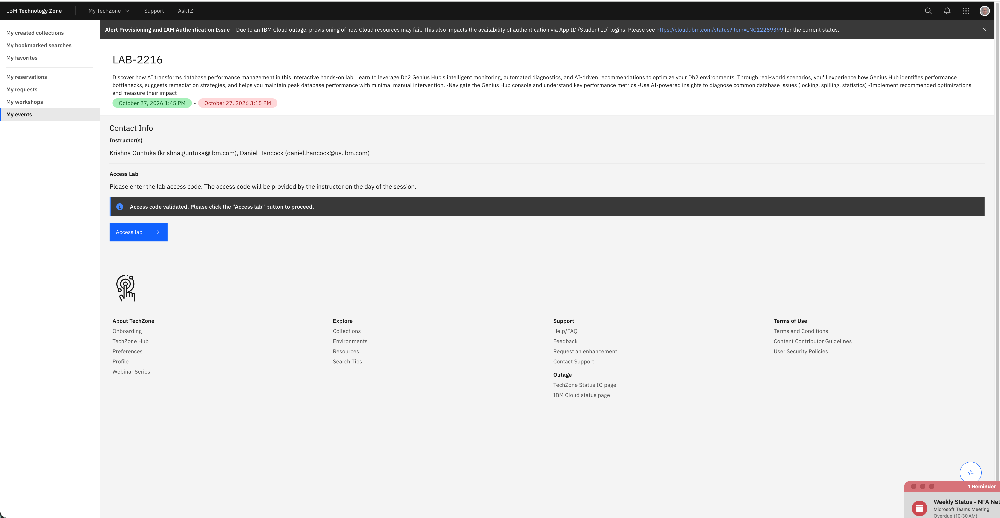
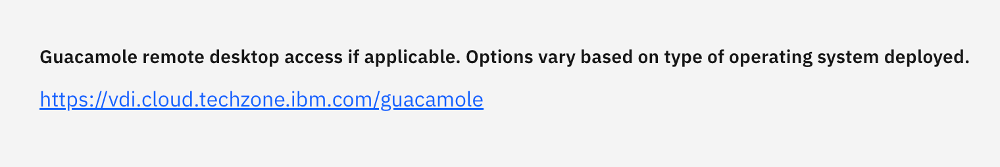
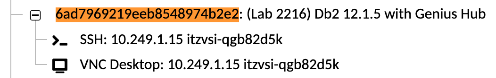

<h1 style="padding-left:16px; border-left:8px solid #378ADD;">IBM Db2 Genius Hub — Hands-On Lab</h1>

**Author:** Daniel Hancock — Daniel.Hancock@us.ibm.com  
**Role:** World-wide Technology Sales — Databases

---

> **© 2026 International Business Machines Corporation.**  
> No part of this document may be reproduced or transmitted in any form without written permission from IBM. U.S. Government Users Restricted Rights — use, duplication or disclosure restricted by GSA ADP Schedule Contract with IBM.
>
> This document is distributed "as is" without any warranty, either express or implied. IBM products and services are warranted per the terms and conditions of the agreements under which they are provided. Performance data and client examples are presented for illustrative purposes only. Actual performance results may vary depending on specific configurations and operating conditions.
>
> Any statements regarding IBM's future direction, intent, or product plans are subject to change or withdrawal without notice. References to IBM products, programs, or services do not imply that IBM intends to make such products available in all countries in which IBM operates.
>
> IBM, the IBM logo, and ibm.com are trademarks of International Business Machines Corporation, registered in many jurisdictions worldwide. A current list of IBM trademarks is available at [www.ibm.com/legal/copytrade.shtml](https://www.ibm.com/legal/copytrade.shtml).

---

<h2 style="padding-left:14px; border-left:6px solid #1D9E75;">Welcome to the Lab</h2>

**AI-Powered Database Performance with Db2 Genius Hub**

Welcome. In this hands-on lab you work with **IBM Db2 Genius Hub**, a web-based console for managing Db2 databases, and its **Agentic AI Assistant**. Instead of writing catalog queries and reading monitor output by hand, you ask the assistant questions in plain English. It investigates, explains what it finds, and recommends a fix. When a change is needed, it asks for your approval before it runs anything.

You work in your own pre-configured environment, which already has Db2, Db2 Genius Hub, and the Agentic AI Simulator installed. You do not need to install anything. You only need a web browser.

**What you will do**

| Exercise | What you will do |
|---|---|
| **Space Management with AI** | Find out which schema is using the space in a tablespace, find the tables and indexes that need a REORG, and have the assistant run the fix after you approve it |
| **WLM Queuing** | Trigger a workload manager queuing problem, then ask the assistant why queries are stuck, apply the fix, and check that the queue clears |
| **Text2SQL** | Turn a complex plain-English question about cricket statistics into Db2 SQL, then run it in the SQL Workbench |
| **Query Tuning** | Run a slow TPC-H query, ask the assistant to tune it, apply the recommended index, and confirm the speedup |

Before the exercises, you set up your environment and connect Db2 Genius Hub to your databases. The **Quick Path** below takes you through exactly those steps, in order. Everything else in this guide is optional background that you can read if you finish early.

---

> **🎯 TechXchange Quick Path** — Short on time? To complete the four featured exercises, follow these pages in order:
> 1. [The Setup](01-setup.md)
> 2. [Using the Guacamole Desktop](01a-guacamole.md)
> 3. [Login and Repository Setup](02-01-login-and-repo.md)
> 4. [Database Connections](02-03-database-connections.md)
> 5. [AI Configuration and Event Monitors](02-05-ai-configuration.md)
> 6. [Space Management with AI](05-01-space-management.md)
> 7. [WLM Queuing](05-02-wlm-queuing.md)
> 8. [Text2SQL](05-03-text2sql.md)
> 9. [Query Tuning](05-04-query-tuner.md)
>
> **How to navigate**
> - **Follow the Quick Path.** At the bottom of each page listed above, use the **🎯 TechXchange Quick Path** line (*Step N of 9*). It takes you straight to the next required page and skips the rest.
> - **Ignore the regular "← Previous | → Next" links** at the bottom of the page for now. They walk through the full lab in order, including pages you do not need for the three featured exercises.
> - **Finished early?** After Text2SQL, go back and complete the other pages (Interface Tour, Monitor Dashboard, Drill-Down, Alerts and Jobs, and so on) using the regular "→ Next" links. They are optional background and build on one another, so work through them in order.

---

<h2 style="padding-left:14px; border-left:6px solid #1D9E75;">Table of Contents</h2>

> 🎯 = **TechXchange Quick Path** (step number shown). Pages without 🎯 are optional.

**[Introduction](00-introduction.md)**

**[1 — The Setup](01-setup.md)** 🎯 *Step 1*
- [Using the Guacamole Desktop](01a-guacamole.md) 🎯 *Step 2*

- [Environment overview](#environment-overview)
- [Accessing the lab environment](#accessing-the-lab-environment)
- [Default credentials](#default-credentials)
- [Setup and configuration](#setup-and-configuration)
- [Architecture summary](#architecture-summary)
- [What you will achieve](#what-you-will-achieve)
- [Next steps](#next-steps)

**[2 — The Basics](02-basics.md)**
- [Login and Repository Setup](02-01-login-and-repo.md) 🎯 *Step 3*
- [Interface Tour](02-02-interface-tour.md)
- [Database Connections](02-03-database-connections.md) 🎯 *Step 4*
- [Monitor Dashboard](02-04-monitor-dashboard.md)
- [AI Configuration and Event Monitors](02-05-ai-configuration.md) 🎯 *Step 5*

**[3 — SQL Workbench](03-workbench.md)**
- [SQL Editor](03-01-sql-editor.md)
- [Visual Explain](03-02-visual-explain.md)
- [Query Tuning](03-03-query-tuning.md)

**[4 — Monitoring Databases](04-monitoring.md)**
- [Drill-Down Investigation](04-01-drill-down.md)
- [Reports](04-02-reports.md)
- [Agentic AI Assistant](04-03-agentic-ai-assistant.md)
- [Alerts and Jobs](04-04-alerts-and-jobs.md)

**[5 — Agentic AI Simulator](05-agentic-ai-simulator.md)**
- [Space Management with AI](05-01-space-management.md) 🎯 *Step 6*
- [WLM Queuing](05-02-wlm-queuing.md) 🎯 *Step 7*
- [Text2SQL](05-03-text2sql.md) 🎯 *Step 8*
- [Query Tuning](05-04-query-tuner.md) 🎯 *Step 9*

<h2 style="padding-left:14px; border-left:6px solid #1D9E75;">Accessing Your Lab Environment</h2>

This lab is delivered through **IBM TechZone**. Your instructor will provide a URL and a lab access code at the start of the session.

**Step 1 — Open the URL and enter the access code**

Navigate to the URL provided by your instructor. Enter the lab access code provided by your instructor, then click **Access Lab**.

Clicking **Access Lab** assigns you a dedicated environment for the lab exercises.

---

**Step 2 — Find your Guacamole link**

Once your environment is assigned, scroll through the environment details and look for the **Guacamole remote desktop access** entry:

Click the link `https://vdi.cloud.techzone.ibm.com/guacamole` to open the Guacamole portal, then click the **VNC Desktop** link for your environment to open the Linux desktop in your browser:

This is the primary interface used throughout the lab.

> **ℹ️ More details** on using the Guacamole desktop — copy/paste, opening a terminal, screen size, and session timeout — are covered in **[Using the Guacamole Desktop](01a-guacamole.md)**.

---

<h2 style="padding-left:14px; border-left:6px solid #1D9E75;">Introduction</h2>

IBM Db2 Genius Hub is a web-based, AI-driven management console for Db2 LUW. It provides intelligent recommendations, data usage insights, and automation tools for quality and performance tuning. By bringing AI-powered observability and guidance, it simplifies administration, enhances performance, reduces operational costs, and lowers management complexity — helping DBAs of all levels manage databases more efficiently and make better decisions.

<h3 style="padding-left:14px; border-left:5px solid #EF9F27;">Key Capabilities</h3>

| Capability | Description |
|---|---|
| **Unified Monitoring** | Monitor all aspects of your databases with graphs, alerts, and metrics in a single view |
| **Drill-Down Analysis** | Drill down from graphs to understand what was happening at a specific point in time |
| **Multi-Environment Support** | Monitor and manage all Db2 instances from a single interface: on-prem, cloud, or hybrid |
| **AI Query Tuner** | Improve query performance with recommended indexes, what-if scenarios, and impact analysis |
| **Intelligent Alerting** | Receive threshold-based alerts with fast diagnostics and resolution recommendations |
| **Job Management** | Comprehensive scheduling, execution, monitoring, and alerting for database jobs |

<h3 style="padding-left:14px; border-left:5px solid #EF9F27;">Not Covered in This Lab</h3>

The following capabilities are part of Db2 Genius Hub, but there are **no lab exercises for them yet**. Exercises will be added in the future.

| Capability | Description |
|---|---|
| **Backup Management** | Manage database backups centrally |
| **Q Replication Integration** | Create, start, stop, and monitor data replication between source and target systems |
| **Custom Dashboards** | Compare behavior across databases using flexible, customizable dashboards |

---

<h2 style="padding-left:14px; border-left:6px solid #1D9E75;">About This Hands-On Lab</h2>

This lab showcases the new features of Db2 Genius Hub and how they assist DBAs in administering Db2 databases using AI. The lab is organized into five parts:

---

<h3 style="padding-left:14px; border-left:5px solid #EF9F27;">The Setup</h3>

> Work within a pre-configured environment providing access to IBM Db2, Db2 Genius Hub, and an Agentic AI application. Become familiar with the environment and perform initial configuration of Db2 Genius Hub.

**[→ The Setup](01-setup.md)**

---

<h3 style="padding-left:14px; border-left:5px solid #EF9F27;">The Basics</h3>

> Learn the fundamentals of Db2 Genius Hub pages and configure event monitors to collect additional performance data.

**[→ Login and Repository Setup](02-01-login-and-repo.md)**

---

<h3 style="padding-left:14px; border-left:5px solid #EF9F27;">SQL Workbench</h3>

> Use the Workbench to manage tables and the AI Query Tuner to generate index recommendations, analyze impact using what-if analysis, and review impact analysis reports.

Topics include:
- Exploring SQL Workbench
- Visual Explain
- Query Tuner
- What-if Analysis
- Impact Analysis Report

**[→ SQL Editor](03-01-sql-editor.md)**

---

<h3 style="padding-left:14px; border-left:5px solid #EF9F27;">Monitoring Databases</h3>

> Analyze database performance issues by drilling into detailed graphs. Leverage recommendations to prevent future occurrences and configure alerts for proactive monitoring.

Topics include:
- Graphs and Filters
- Reports
- Database Assistant
- Alerts and Jobs

**[→ Drill-Down Investigation](04-01-drill-down.md)**

---

<h3 style="padding-left:14px; border-left:5px solid #EF9F27;">Agentic AI Simulator</h3>

> Interact with the Db2 Agentic AI Simulator to trigger performance scenarios and see how the AI service detects and resolves issues.

Capabilities include:
- Loading TPC-H benchmark data for testing
- Simulating WLM queuing scenarios
- Triggering query spilling events
- Creating locking contention
- Testing space management issues
- Demonstrating blocking scenarios
- Running runstats operations

> **ℹ️ About the Simulator:** The **Db2 Agentic AI Simulator** is a separate, as-is application (not part of Db2 Genius Hub) provided for hands-on lab tasks. It allows you to trigger events that demonstrate how the Db2 agentic AI service solves problems.

**[→ Agentic AI Simulator](05-agentic-ai-simulator.md)**

---

<h2 style="padding-left:14px; border-left:6px solid #1D9E75;">Available Datasets</h2>

<h3 style="padding-left:14px; border-left:5px solid #EF9F27;">Text2SQL</h3>

| Dataset | Description |
|---|---|
| **Cricket Statistics** | Batting, bowling, and fielding records |
| **Supply Chain Data** | Products, inventory, orders, and shipments |
| **TPC-H Benchmark** | Decision support data: suppliers, customers, orders, and parts |

<h3 style="padding-left:14px; border-left:5px solid #EF9F27;">Performance Simulator</h3>

| Dataset | Description |
|---|---|
| **TPC-H Dataset** *(prerequisite)* | Load TPC-H benchmark data required by all performance simulators |
| **Cricket Statistics** | Detailed cricket statistics for performance testing |
| **Supply Chain Data** | Supply chain data for performance testing |
| **TPC-H Benchmark** | Full TPC-H decision support benchmark dataset |

**Available performance simulation scenarios:**

| Scenario | Description |
|---|---|
| WLM Queuing | Simulate workload manager sort memory queuing |
| Query Spilling | Trigger sort spill-to-disk events |
| Locking | Create locking contention between sessions |
| Space Management | Test tablespace space management issues |
| Blocking | Demonstrate transaction blocking scenarios |
| Runstats | Run statistics collection operations |

---

<h2 style="padding-left:14px; border-left:6px solid #1D9E75;">Next Steps</h2>

This completes the introduction to Db2 Genius Hub.

**[→ The Setup](01-setup.md)**

---
