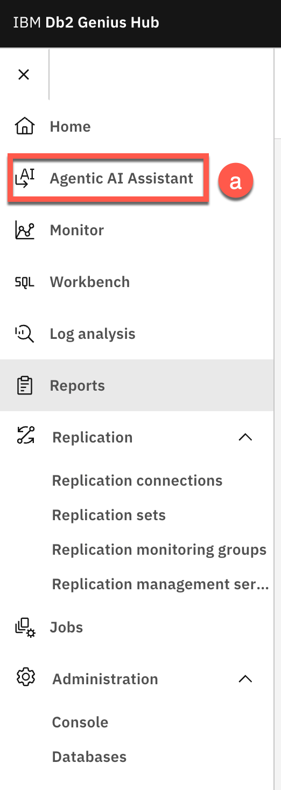
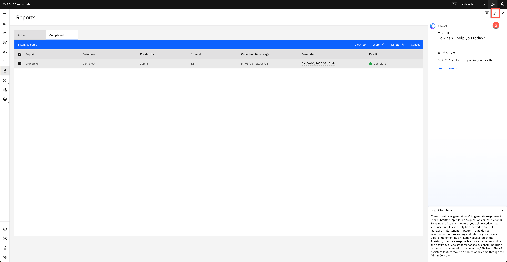
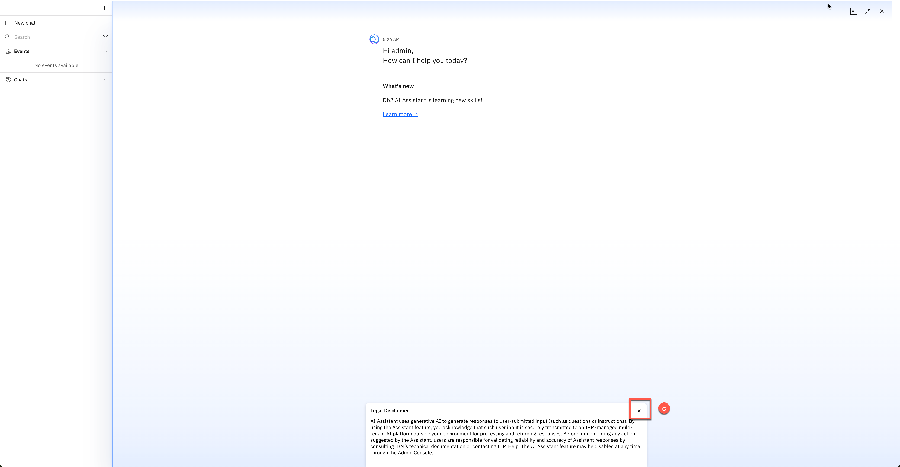
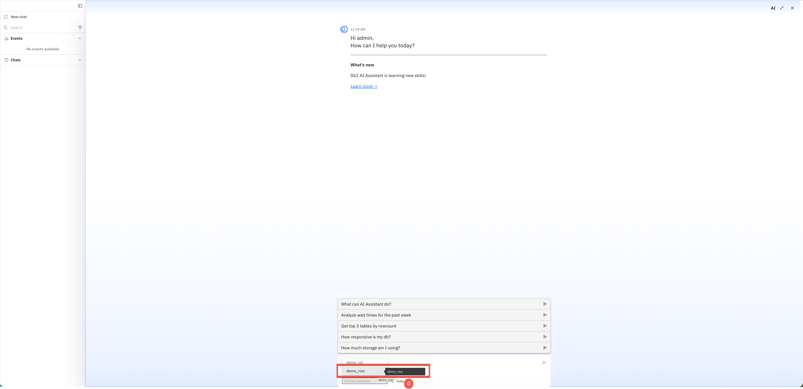
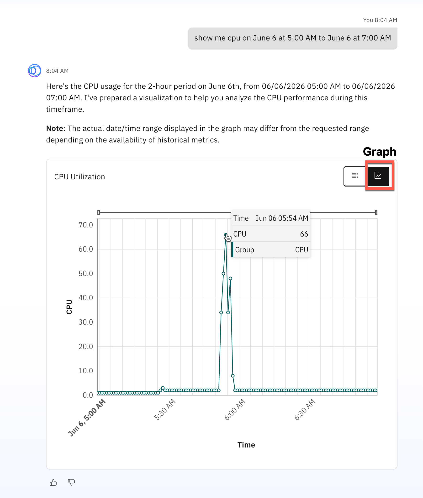
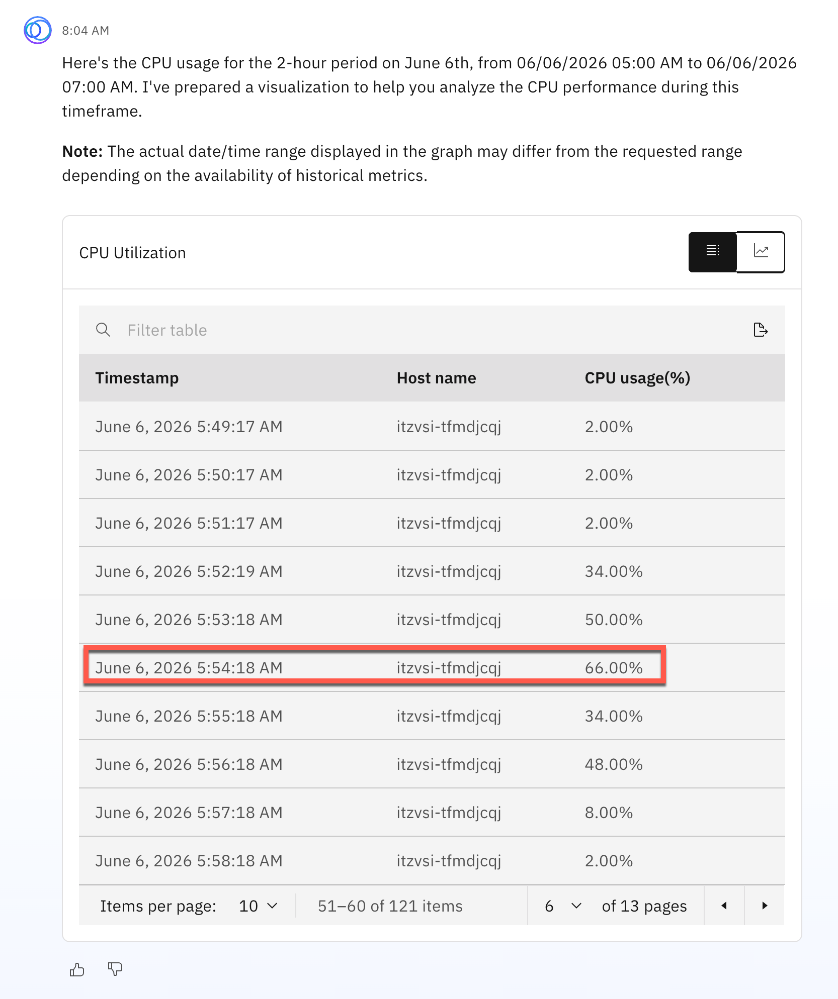
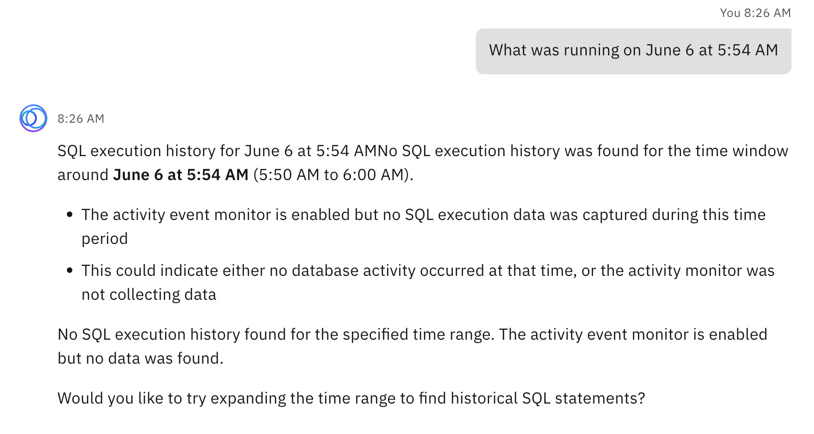
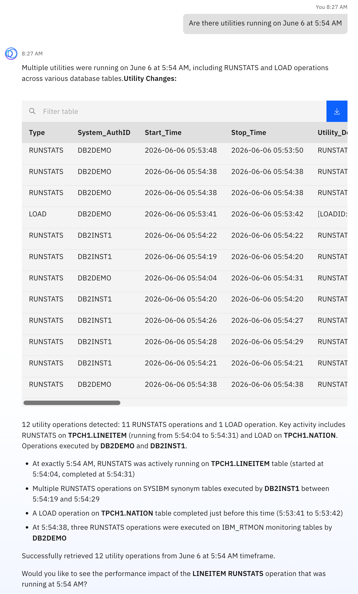
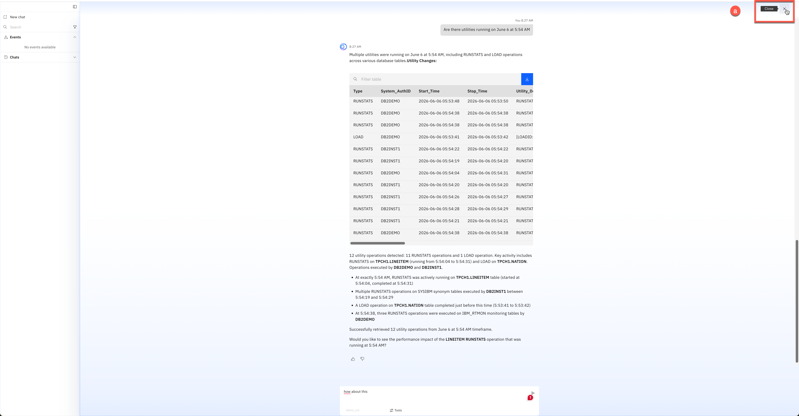

<h1 style="padding-left:16px; border-left:8px solid #378ADD;">Agentic AI Assistant</h1>


1. Click the **Agentic AI Assistant (a)** menu item.

   

2. Expand the AI Assistant by clicking the expand button **(b)**.

   

3. Read and close the **Legal Disclaimer (c)**.

   

4. In the **Ask a question... (d)** field, choose `demo_col` in the **Choose Database** field.

   

5. Enter a natural language query for the time period of your anomaly and press Enter. For example:

   ```
   show me cpu on June 6 at 5:00 AM to June 6 at 7:00 AM
   ```

   > **⚠️ Change the date and time** to match the anomaly you observed earlier.

   The Database Assistant applies the filter and creates a result box with a **Graph** view and a **Data** view. Click each to see the results.

   **Graph view:**

   

   **Data view:**

   

6. You will see the CPU usage spike at the time of the anomaly (e.g., 66% at 5:54:18 AM).

   

7. Ask a follow-up question:

   ```
   What was running on June 6 at 5:54 AM
   ```

   

   > The assistant searched for SQL running at this time and returned no result. Provide more context — the CPU wouldn't spike without a running process.

8. Ask the assistant to look for other processes:

   ```
   Are there utilities running?
   ```

   

   > **ℹ️ Note:** Since this is the same chat session, the assistant retains context from your previous question, including the time range. Starting a new session clears this context.

   The assistant responds with a detailed breakdown of utility activity — identifying 12 utility operations (11 RUNSTATS and 1 LOAD) and presenting them in a filterable table.

9. **Optional:** Try these additional questions to explore the assistant's capabilities:

   **Monitoring and Performance:**
   - `What are the configuration parameters for my database?`
   - `Show me time spent on various processing`
   - `Show me my database performance from 3 days ago until today`
   - `What is the query throughput of the system today?`
   - `List top 3 longest running queries`
   - `CPU summary` / `Memory summary`

   **Navigation:**
   - `Take me to the home page`
   - `Take me to the workbench`

   **Schema and Storage:**
   - `What's my top 5 largest tables by storage size?`
   - `List of schemas`
   - `Storage utilization by tablespace`
   - `Show me DDL`

   **Statistics:**
   - `Get outdated statistics`
   - `Give me outdated stats for schema ibm_rtmon with row changes of 20% or more in last 5 hours`

   **Conversational Examples:**
   - `How can I cast XML data to non-XML data?`
   - `What are some WLM objects? Show in a tabular fashion`
   - `What does this SQL do?`
   ```sql
   SELECT eee.workdept AS dp#, eee.empno, aaa.projno, ppp.prstaff AS staff
   FROM (SELECT * FROM employee
         WHERE lastname LIKE '%A%'
         AND job <> 'DESIGNER'
         AND workdept BETWEEN 'B' AND 'E') AS eee
   LEFT OUTER JOIN emp_act aaa ON aaa.empno = eee.empno AND aaa.emptime <= 0.5
   INNER JOIN project ppp ON aaa.projno = ppp.projno AND ppp.projname LIKE '%Q%'
   ORDER BY eee.workdept, eee.empno, aaa.projno;
   ```

---

<h2 id="space-management" style="padding-left:14px; border-left:6px solid #1D9E75;">Space Management with AI</h2>

> **Persona:** DBA &nbsp;|&nbsp; **Skill level:** Beginner &nbsp;|&nbsp; **Estimated time:** 10 min

A tablespace is filling up. Instead of writing catalog queries and reading REORGCHK output by hand, ask the AI assistant in plain language. It shows where the space is going, tells you which objects need a REORG and why, and gives you the exact commands — then runs them with your approval at every step.

---

<h3 style="padding-left:14px; border-left:5px solid #EF9F27;">Step 0 — Set Up the Simulators</h3>

Before asking questions, load a dataset and run the space-management scenarios so the database has something to analyze.

1. In the Agentic Demo Simulator (`http://localhost:3000`), under **Performance Simulators**, click **Load data** next to the **TPCH** dataset.

2. Choose the **SF 1.0 (Huge)** dataset and wait for the load to complete.

   > ⏳ This may take a few minutes.

3. Under **Space Management**, click **Run scenarios** next to **Rowstore REORGCHK scenarios**.

4. Select all scenarios and click **Run selected**.

5. Confirm no simulators show an error before proceeding.

---

<h3 style="padding-left:14px; border-left:5px solid #EF9F27;">Step 1 — Space by Schema</h3>

In the Genius Hub AI Assistant (with `demo_col` selected), enter:

```
Break down disk space usage by schema
```

The assistant returns one row per schema so the biggest consumers stand out immediately. Notice the **proactive offer** — it will suggest running REORGCHK on the `SIMULATOR` schema as the natural next step.

---

<h3 style="padding-left:14px; border-left:5px solid #EF9F27;">Step 2 — Largest Table in SIMULATOR</h3>

Focus on the `SIMULATOR` schema by asking:

```
What is the largest table in the SIMULATOR schema?
```

The answer lists tables with the largest first, in descending order.

---

<h3 style="padding-left:14px; border-left:5px solid #EF9F27;">Step 3 — Analyze the Schema for Space Reclamation</h3>

Ask the assistant to analyze the whole schema:

```
Analyze schema SIMULATOR for space reclamation
```

The response is thorough: which tables need a REORG, which indexes need a REORG, and the exact command to run for each one.

> **Tip:** When several tables need a REORG, the index section may be skipped to keep the answer short. You can ask for indexes at any time — for the whole schema or for one specific object.

---

<h3 style="padding-left:14px; border-left:5px solid #EF9F27;">Step 4 — Ask About Indexes Specifically</h3>

```
Which indexes in schema SIMULATOR need reorganization?
```

The assistant responds with a detailed table including:
- REORGCHK indicator values (F4–F8) for each index
- One ready-to-run REORG command per index
- A reminder to enable the `RTMON_EVMON_UTILITY` event monitor in Genius Hub to track REORG history

---

<h3 style="padding-left:14px; border-left:5px solid #EF9F27;">Step 5 — Step-by-Step Instructions for One Table</h3>

Pick one table from the list and ask how to fix it:

```
Give me step-by-step instructions to reorganize SIMULATOR.REORG_F1_TEST
```

The assistant gives you the whole procedure:
1. Run the REORG
2. Run RUNSTATS to update table statistics
3. Check that statistics were updated

---

<h3 style="padding-left:14px; border-left:5px solid #EF9F27;">Step 6 — Let the Assistant Run It, With Your Approval</h3>

For an online (INPLACE) REORG you do not need to copy and paste commands. Ask the assistant to execute:

```
Can you please run the reorg for me?
```

The assistant asks for your **explicit approval before each step**, runs what you approve, and confirms when the REORG was successful.

> **ℹ️ Note:** Explicit human approval is required before any database change is applied — you remain in full control at all times.

---

<h3 style="padding-left:14px; border-left:5px solid #EF9F27;">Step 7 — Check Again</h3>

After the REORG completes, ask the assistant to verify the space was reclaimed:

```
Check the space for SIMULATOR schema again
```

Compare the before and after results — you should see the fragmented space recovered.

> **➡️ TechXchange Quick Path — next exercise:** Continue with **[WLM Queuing](05-agentic-ai-simulator.md#wlm-queuing)**.

---

<h3 style="padding-left:14px; border-left:5px solid #EF9F27;">Operation Modes</h3>

Db2 Genius Hub provides 2 additional operation modes for the Database Assistant:

| Mode | Description |
|---|---|
| **Agent Mode** | Supports troubleshooting and monitoring tasks; natural language to SQL code generation |
| **Deep Research** | Performs in-depth research and generates a report with sources and citations |

**How it works:**

1. Enter a research or troubleshooting prompt. If unclear, the assistant asks follow-up questions.
2. The assistant streams progress updates: planning, researching, validating, and report generation.
3. When complete, view both the answer and detailed research activity with citations.

<h4 style="padding-left:14px; border-left:4px solid #888780;">Agent Mode Sample Questions</h4>

Ensure **Agent Mode (a)** is selected, then try:

- `Generate a SQL to find all players from US who have scored more than 1000 runs in World Cups`
- `Generate a SQL to list all players along with their countries who have taken more than 30 wickets in World Cup cricket`
- `Generate a SQL to find all players who have both batting and bowling records in World Cups, showing their total runs and total wickets`

Agent Mode also handles:

| Category | Examples |
|---|---|
| Performance troubleshooting | WLM queuing, slow queries |
| Locking issues | Deadlocks, lock waits |
| Database health checks | Overall health summary |
| What's changed analysis | Config and schema changes |
| Blocking transactions | Identify and resolve blockers |
| Text2SQL | Natural language to SQL |
| Conversational search | Ask questions in plain English |

<h4 style="padding-left:14px; border-left:4px solid #888780;">Deep Research Sample Questions</h4>

- `How to set up HADR in db2?`
- `Are there any queuing taking place? If so, can you tell me which is in the head of the queue?`
- `Why is my query running slow? Can you reason out the same?`
- `Show me the log file size settings for my DB2 database`
- `Can you do a quick health check of my DB2 database?`
- `Show me all the waiting locks held by application handle`
- `What is the current buffer pool hit ratio in my database?`
- `What activities are currently running in my database?`
- `How much of my transaction log space is currently being used?`

<h4 style="padding-left:14px; border-left:4px solid #888780;">Close the Agentic AI Assistant</h4>

Click the **Close (a)** button in the top right corner of the Agentic AI Assistant window.



---

---

**[← Reports](04-02-reports.md)** &nbsp;&nbsp;|&nbsp;&nbsp; **[→ Alerts and Jobs](04-04-alerts-and-jobs.md)**

---
