<h1 style="padding-left:16px; border-left:8px solid #378ADD;">Space Management with AI</h1>

> **Persona:** DBA

**The task.** A tablespace is filling up. Find which schema is using the space, find the tables and indexes in it that need a REORG, and fix them. You do all of it by asking questions in plain language.

**The story.** Space is tight and you need to know where it went and what can be safely recovered. Instead of writing catalog queries and reading REORGCHK output by hand, you ask the assistant in plain language. It shows where the space is, tells you which objects are worth reorganizing and why, and gives you the exact commands in the right order. When a change is needed it asks for your approval before it runs anything, then re-checks the result so you can see what changed.

---

<h3 style="padding-left:14px; border-left:5px solid #EF9F27;">Step 0 — Set Up the Simulators</h3>

Before you ask any questions, open the simulator, load a data set and run the space-management scenarios so the database has something to analyze.

1. Open the Agentic AI Simulator. It runs on the lab VM, so open it in **Firefox inside the Guacamole desktop**, not in a browser on your own laptop.

   1. In the Guacamole desktop, switch to **Firefox**. If you cannot see it, click **Activities** (top-left corner) and click **Firefox** in the dash at the bottom of the screen.
   2. Click the **+** button in the Firefox tab bar to open a new tab.
   3. In the address bar, type `http://localhost:3000` and press **Enter**.

   > **ℹ️ Tip:** Keep the Lab Guide in one tab and the simulator in another, and click the tabs to switch between them.

2. Connect the simulator to the `demo_row` database. The space-management tasks use the row-organized database, because REORG applies to row-organized tables. Click **Connect DB** in the top-right corner.

   

3. In the **Connect Database** window, enter these details:

   | Field | Value |
   |---|---|
   | Host | `localhost` |
   | Database | `demo_row` |
   | User | `db2demo` |
   | Password | `Db2ghPassw0rd#1` |
   | Port | `25010` |

   Leave **Enable SSL Connection** unchecked.

4. Click **Test Connection**. When the connection works, a green **Connected** badge appears at the top right. Do not continue until it is green.

   

5. You do not need to load data. The `TPCH1`, `TPCH2` and `TPCH3` schemas are already loaded in `demo_row`, so skip **Load data** under **Performance Simulators**.

6. Under **Space Management**, click **Run scenarios** next to **Rowstore REORGCHK scenarios**.

7. Select all scenarios and click **Run selected**.

   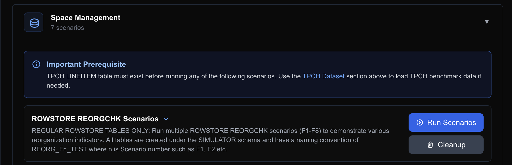

   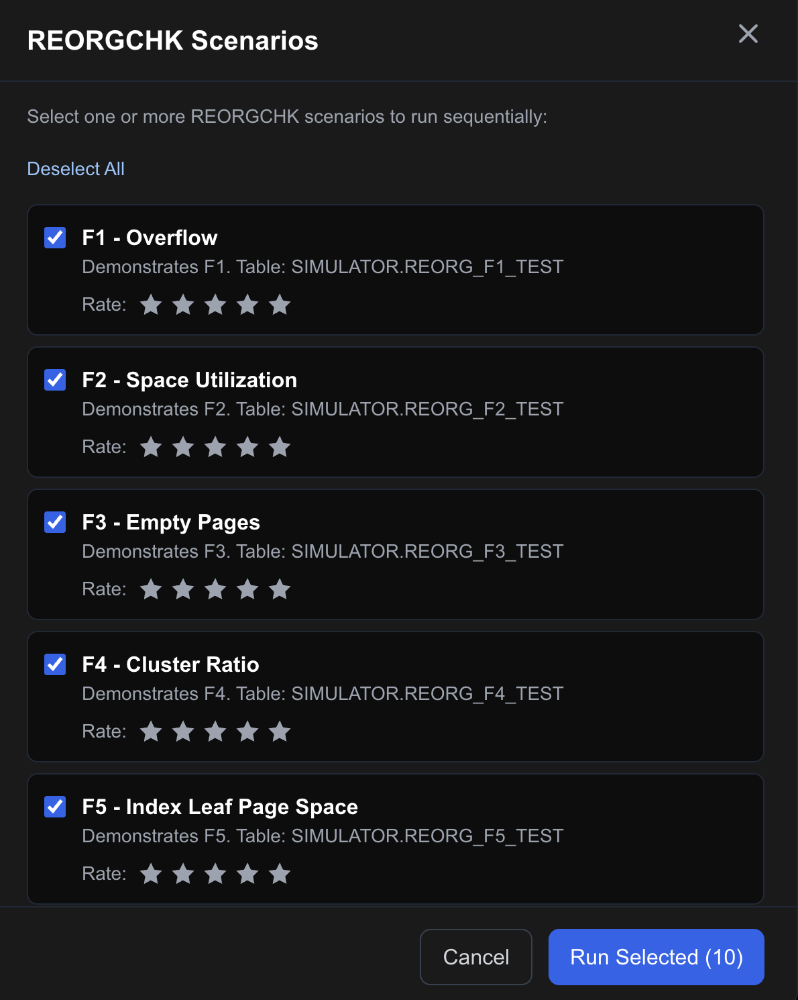

8. In the **Run REORGCHK Scenarios** dialog, enter `TPCH1` as the **Schema Name** and click **Run Scenarios**.

   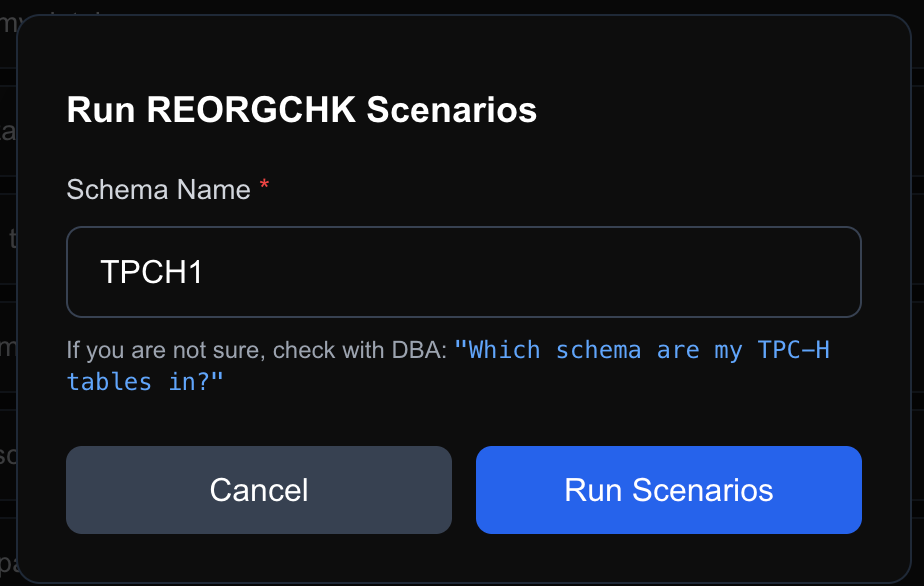

9. Check that none of the simulators shows an error in the UI before you start asking questions.

10. Wait for the scenario log in the simulator UI to show `F1F2F3: Scenario complete - ... rows remaining`. This is the last scenario and takes about 5 minutes. Do not start asking questions until it appears.

   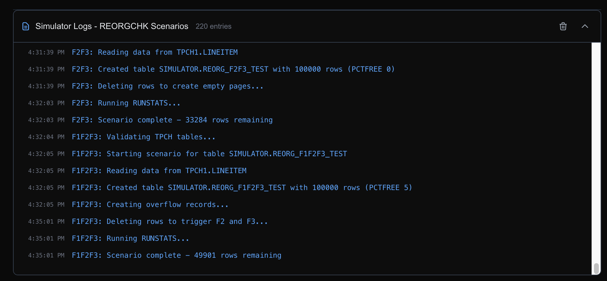

---

<h3 style="padding-left:14px; border-left:5px solid #EF9F27;">Step 1 — Start with a Broad Question: Disk Space by Schema</h3>

You do not need to know any schema or table names up front. Start broad and let the assistant show you the landscape.

First, open the Assistant in Genius Hub:

1. Click the **Agentic AI Assistant** menu item.

   

2. Expand the AI Assistant by clicking the expand button.

   

3. Read and close the **Legal Disclaimer**.

   

4. In the **Choose Database** field, choose `demo_row`.

   

Then ask:

**You ask:**

```
Break down disk space usage by schema
```

> **Note:** If you are prompted for **Personal credentials**, enter the `demo_row` connection details from Step 0 (user `db2demo`, password `Db2ghPassw0rd#1`), click **Test connection**, make sure **Save credentials to repository** is selected, then click **OK**.

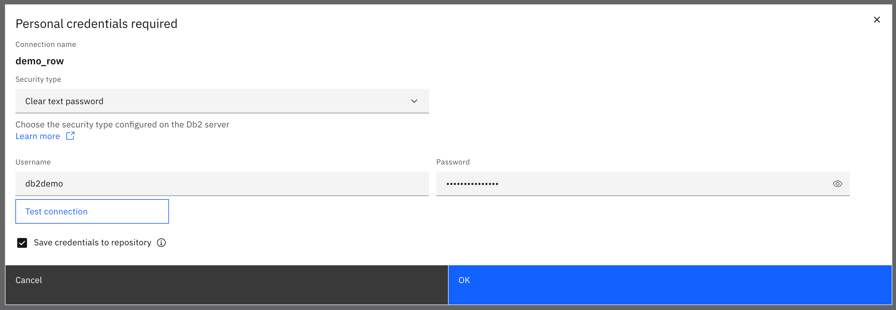

> **Note:** The assistant then shows the SQL it wants to run (an explanation such as "Calculate total physical size … by schema using ADMIN_GET_TAB_INFO monitoring function", followed by the query) and asks you to respond with `approve` to execute it or `reject` to cancel. Select **approve**.

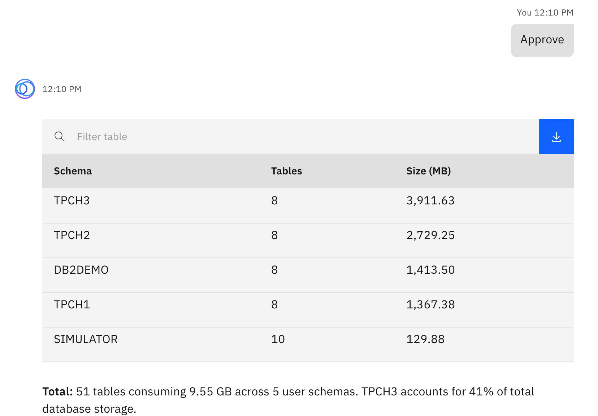

- **Space by schema.** One row per schema with its table count and size in MB, largest first, so the biggest consumers stand out straight away.
- **A summary line.** The assistant totals the tables and storage across the user schemas and tells you which schema accounts for the largest share.

---

<h3 style="padding-left:14px; border-left:5px solid #EF9F27;">Step 2 — Focus on One Schema: Storage and Page Statistics for SIMULATOR</h3>

For this example we focus on a schema called `SIMULATOR`. First look at how its storage is split across tables, then add the page statistics that point to fragmentation.

**You ask:**

```
Break down the storage usage for the tables in the SIMULATOR schema.
```

The assistant may need to run more than one query to answer (for example, to check the available columns and the table organization). Select **approve** each time it asks.

- **Storage per table.** Total size, data size, index size and row count for each table, largest first.
- **A summary line.** The number of tables, the total size in MB, and whether the tables are row-organized.

Now ask for the page statistics:

**You ask:**

```
Include Overflow, NPAGES, FPAGES for the tables in SIMULATOR
```

Select **approve** for each query the assistant proposes.

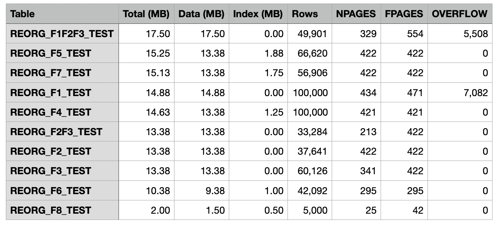

- **Page statistics added.** The same table now also shows `NPAGES`, `FPAGES` and `OVERFLOW` for each table.

**Key findings:**

- `REORG_F1F2F3_TEST`: 5,508 overflow records (11% of rows) and `FPAGES` (554) significantly exceeds `NPAGES` (329), which indicates fragmentation.
- `REORG_F1_TEST`: 7,082 overflow records (7% of rows) with `FPAGES` > `NPAGES` (471 vs 434), so it is also fragmented.
- Both tables with overflow records are candidates for reorganization to reclaim space and improve performance.

---

<h3 style="padding-left:14px; border-left:5px solid #EF9F27;">Step 3 — Analyze the Schema for Space Reclamation</h3>

Now ask the assistant to analyze the whole schema. The response is thorough: how much space can be reclaimed, which tables and indexes need a REORG and why, and the commands to run in a recommended order.

**You ask:**

```
Analyze schema SIMULATOR for space reclamation
```

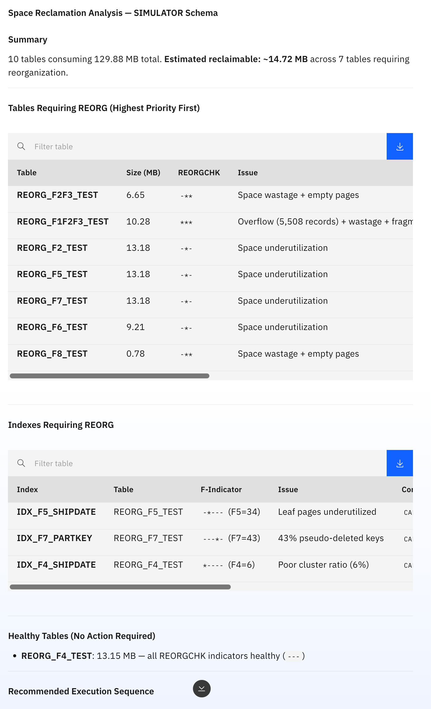

- **Summary.** 10 tables consuming 129.88 MB in total, with an estimated ~14.72 MB reclaimable across 7 tables that need a REORG.
- **Tables requiring REORG.** Listed highest priority first. For each table you see its size, the REORGCHK result, the issue found, the estimated space it would reclaim, and the REORG command to run. For example, `REORG_F1F2F3_TEST` is flagged for overflow (5,508 records), wastage and fragmentation, and `REORG_F2F3_TEST` for space wastage and empty pages.
- **Indexes requiring REORG.** Listed separately, with the F-indicator value, the issue and the command: `IDX_F5_SHIPDATE` (leaf pages underutilized), `IDX_F7_PARTKEY` (43% pseudo-deleted keys) and `IDX_F4_SHIPDATE` (poor cluster ratio, 6%).
- **Healthy tables.** Tables with no action required, here `REORG_F4_TEST`, where all REORGCHK indicators are healthy.
- **Recommended execution sequence.** The assistant orders the work:
  1. High-priority table REORGs (reclaim 13.56 MB):

     ```
     CALL SYSPROC.ADMIN_CMD('REORG TABLE SIMULATOR.REORG_F2F3_TEST');
     CALL SYSPROC.ADMIN_CMD('REORG TABLE SIMULATOR.REORG_F1F2F3_TEST');
     ```

  2. Medium-priority table REORGs (improve space efficiency):

     ```
     CALL SYSPROC.ADMIN_CMD('REORG TABLE SIMULATOR.REORG_F2_TEST');
     CALL SYSPROC.ADMIN_CMD('REORG TABLE SIMULATOR.REORG_F5_TEST');
     CALL SYSPROC.ADMIN_CMD('REORG TABLE SIMULATOR.REORG_F7_TEST');
     CALL SYSPROC.ADMIN_CMD('REORG TABLE SIMULATOR.REORG_F6_TEST');
     CALL SYSPROC.ADMIN_CMD('REORG TABLE SIMULATOR.REORG_F8_TEST');
     ```

  3. Index REORGs, after the table REORGs complete:

     ```
     CALL SYSPROC.ADMIN_CMD('REORG INDEXES ALL FOR TABLE SIMULATOR.REORG_F5_TEST');
     CALL SYSPROC.ADMIN_CMD('REORG INDEX SIMULATOR.IDX_F7_PARTKEY CLEANUP');
     CALL SYSPROC.ADMIN_CMD('REORG INDEXES ALL FOR TABLE SIMULATOR.REORG_F4_TEST');
     ```

  4. Optional, return the freed space to the operating system:

     ```
     ALTER TABLESPACE USERSPACE1 REDUCE MAX;
     ```

- **Tablespace context.** `USERSPACE1` is 9,728 MB and 99% utilized, with auto-resize enabled (unlimited). After the REORGs complete, `REDUCE MAX` can return ~14.72 MB to the storage pool.

> **Note:** Nothing has been run yet. The assistant has only analyzed the schema and listed the commands. [Step 6](#step-6) shows how to have the assistant run a REORG for you, with your approval.

---

<h3 style="padding-left:14px; border-left:5px solid #EF9F27;">Step 4 — Ask About Indexes Specifically</h3>

Ask for the indexes that need reorganization. The assistant answers with a detailed table again.

**You ask:**

```
Which indexes in schema SIMULATOR need reorganization?
```

The assistant runs two queries to answer. Select **approve** each time it asks:

1. `CALL SYSPROC.REORGCHK_IX_STATS('S', 'SIMULATOR')` gets the F4 to F8 indicators for the indexes on all tables in the `SIMULATOR` schema.
2. A `SELECT` from `SYSCAT.INDEXES` gets the index statistics for the schema (cluster ratio, leaf pages, levels, density and statistics time).

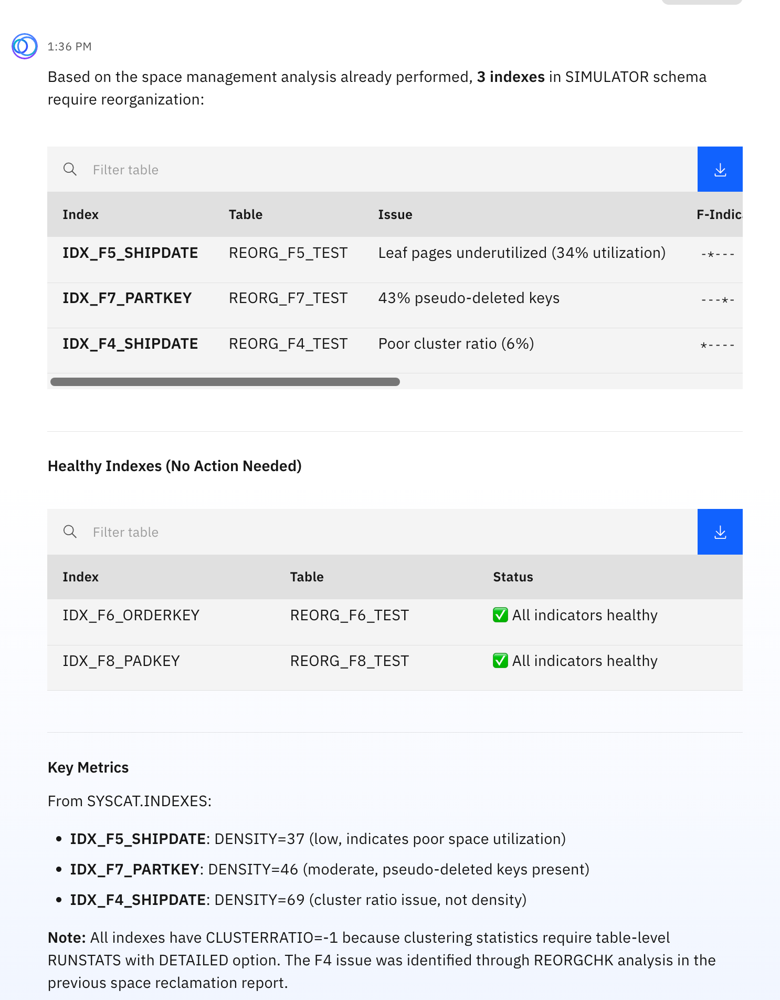

> **Note:** Scroll to the right on the table of the 3 indexes to see the recommended commands.

**Indexes requiring REORG:**

| Index | Table | Issue | F-Indicator | Recommended Action |
|---|---|---|---|---|
| **IDX_F5_SHIPDATE** | REORG_F5_TEST | Leaf pages underutilized (34% utilization) | `-*---` (F5=34) | `CALL SYSPROC.ADMIN_CMD('REORG INDEXES ALL FOR TABLE SIMULATOR.REORG_F5_TEST');` |
| **IDX_F7_PARTKEY** | REORG_F7_TEST | 43% pseudo-deleted keys | `---*-` (F7=43) | `CALL SYSPROC.ADMIN_CMD('REORG INDEX SIMULATOR.IDX_F7_PARTKEY CLEANUP');` |
| **IDX_F4_SHIPDATE** | REORG_F4_TEST | Poor cluster ratio (6%) | `*----` (F4=6) | `CALL SYSPROC.ADMIN_CMD('REORG INDEXES ALL FOR TABLE SIMULATOR.REORG_F4_TEST');` |

- **Indexes requiring REORG.** The 3 indexes that were flagged, each with the REORGCHK indicator value that shows why.
- **Healthy indexes.** `IDX_F6_ORDERKEY` and `IDX_F8_PADKEY` need no action; all their indicators are healthy.
- **Key metrics.** From `SYSCAT.INDEXES`: the density is 37 for `IDX_F5_SHIPDATE` (low, poor space utilization), 46 for `IDX_F7_PARTKEY` (moderate, pseudo-deleted keys present) and 69 for `IDX_F4_SHIPDATE` (a cluster ratio issue, not density).
- **Cluster ratio note.** All indexes show `CLUSTERRATIO` = -1, because clustering statistics need table-level RUNSTATS with the DETAILED option. The F4 issue was identified through the REORGCHK analysis in the previous step.

> **Note:** The commands in the table have not been run. [Step 6](#step-6) shows how to have the assistant run a REORG for you, with your approval.

---

<h3 style="padding-left:14px; border-left:5px solid #EF9F27;">Step 5 — Get Step-by-Step Instructions for a Single Table</h3>

Pick one table from the list and ask how to fix it. The assistant gives you the whole procedure.

The assistant runs three read-only queries first. Select **approve** each time it asks.

**You ask:**

```
Give me step-by-step instructions to reorganize SIMULATOR.REORG_F1_TEST
```

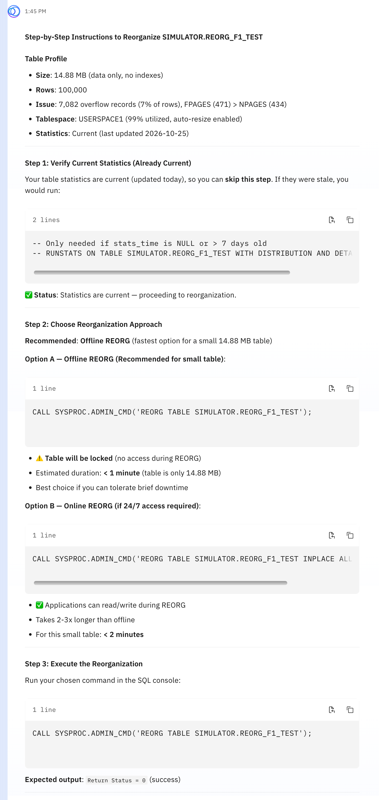

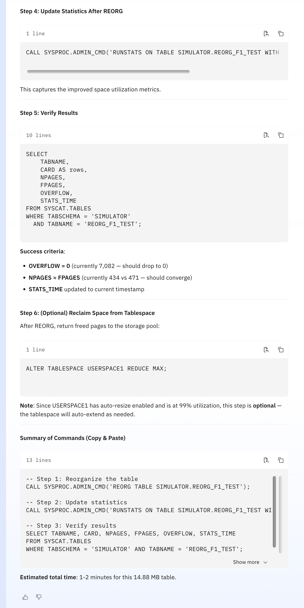

> **Note:** The commands have not been run yet. [Step 6](#step-6) shows how to have the assistant run them for you, with your approval.

---

<h3 id="step-6" style="padding-left:14px; border-left:5px solid #EF9F27;">Step 6 — Let the Assistant Run It, with Your Approval</h3>

You do not have to copy and paste the commands from Step 5. Ask the assistant to run the REORG for you. It asks for your approval before each step, runs what you approve, and finishes by reporting the results.

**You ask:**

```
Can you please run the reorg for me?
```

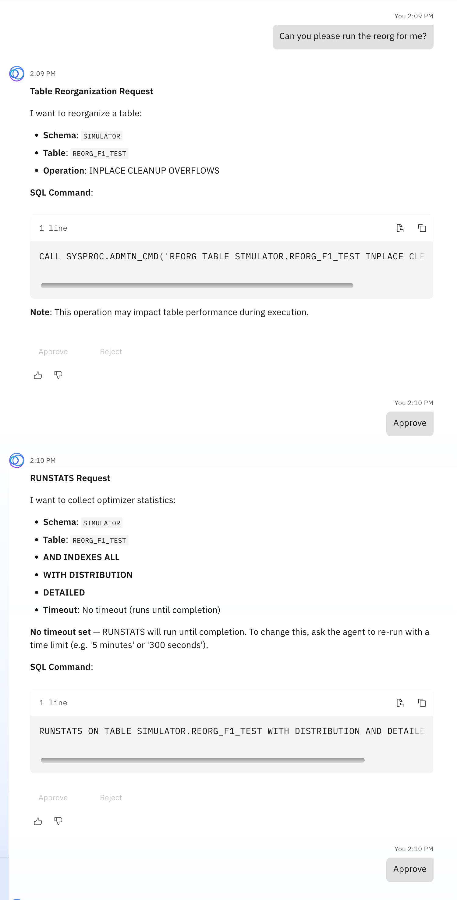

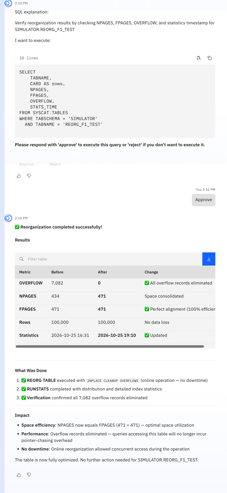

- **REORG.** The assistant runs an online REORG: `CALL SYSPROC.ADMIN_CMD('REORG TABLE SIMULATOR.REORG_F1_TEST INPLACE CLEANUP OVERFLOWS')`. The approval card shows the exact command with **Approve** and **Reject** buttons. Nothing runs until you approve it. An online REORG leaves the table available while it runs.
- **RUNSTATS.** After you approve the REORG, the assistant asks to run `RUNSTATS ON TABLE SIMULATOR.REORG_F1_TEST WITH DISTRIBUTION AND DETAILED INDEXES ALL` to update the statistics.
- **Verify.** After you approve RUNSTATS, the assistant asks to run a `SELECT` that checks `NPAGES`, `FPAGES`, `OVERFLOW` and the statistics time.
- **Final result.** The assistant reports that the REORG completed successfully, with a before and after table:

| Metric | Before | After |
|---|---|---|
| `OVERFLOW` | 7,082 | 0 |
| `NPAGES` | 434 | 471 |
| `FPAGES` | 471 | 471 |
| Rows | 100,000 | 100,000 |

All overflow records are gone, `NPAGES` now equals `FPAGES`, and no rows were lost.

---

<h3 style="padding-left:14px; border-left:5px solid #EF9F27;">Step 7 — Check Again: the F1 Issue Is Gone</h3>

Ask the assistant to check the table again. It confirms that the F1 indicator that flagged the table is no longer a problem.

**You ask:**

```
Check again whether SIMULATOR.REORG_F1_TEST still needs a reorg
```

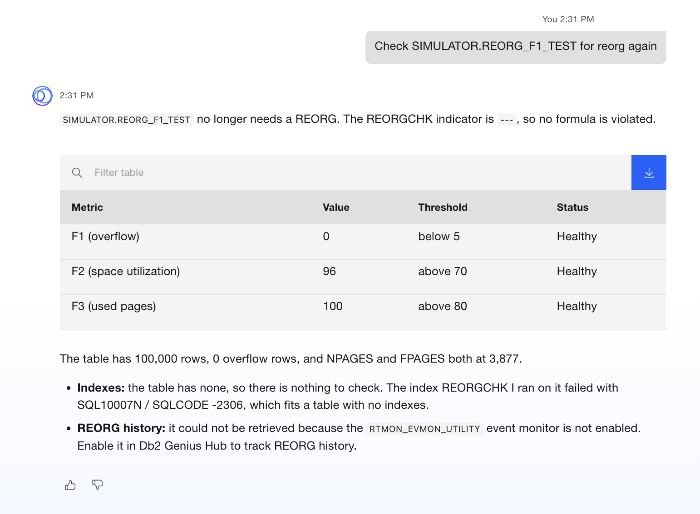

- **No reorganization needed.** The assistant reports that `SIMULATOR.REORG_F1_TEST` does not need a REORG.
- **REORGCHK results.** F1 (overflow) is now 0, below the threshold of 10. F2 (space utilization) is 98 and F3 (used pages) is 100, and both are healthy. The REORG indicator is `---`, which means no action is needed.
- **Space metrics.** 14.71 MB (471 pages), 0 overflow records (it was 7,082), `NPAGES` = `FPAGES` = 471, and 100,000 rows. The statistics are current.

---

🎯 **TechXchange Quick Path — Step 6 of 9:** **[← AI Configuration and Event Monitors](02-05-ai-configuration.md)** &nbsp;&nbsp;|&nbsp;&nbsp; **[→ WLM Queuing](05-02-wlm-queuing.md)**
