<h1 style="padding-left:16px; border-left:8px solid #378ADD;">Troubleshooting WLM Queuing</h1>

Queries are accumulating in the Db2 Workload Manager (WLM) admission queue and are unable to begin execution, delaying workload processing. Diagnosing the root cause traditionally requires manually querying Db2 monitoring interfaces and investigating resource constraints, such as thread limits, sort-memory limits, and service-class configurations.

With the IBM Db2 Genius Hub AI assistant, you can troubleshoot the bottleneck simply by asking questions in plain English. The assistant autonomously investigates the active workload, pinpoints the constrained resource and any recent configuration changes responsible, identifies blocking queries, and presents targeted remediation options to clear the queue and restore query execution.

---

<h3 style="padding-left:14px; border-left:5px solid #EF9F27;">Step 0 — Simulate the Issue</h3>

1. In the demo UI, click **Connect DB (1)** and connect to the `demo_col` database. The WLM scenario uses the column-organized database. Once connected, navigate to the **Simulator** tab **(2)**.

   | Field | Value |
   |---|---|
   | Host | `localhost` |
   | Database | `demo_col` |
   | User | `db2demo` |
   | Password | `Db2ghPassw0rd#1` |
   | Port | `25010` |

   Leave **Enable SSL Connection** unchecked. Click **Test Connection** and wait for the green **Connected** badge.

   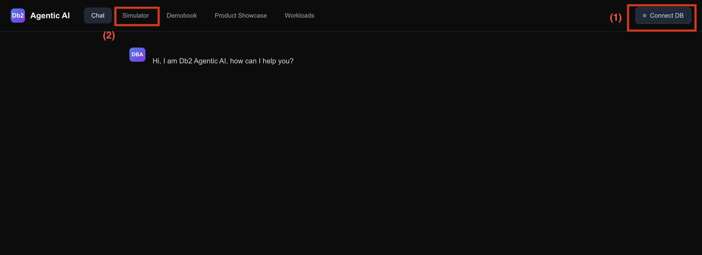

2. You do not need to load data. The `TPCH1`, `TPCH2` and `TPCH3` schemas are already loaded in `demo_col`, so skip **Load Data**. `TPCH1` holds the 1 GB dataset.

3. Click the **WLM Queuing** dropdown. The `db2inst1` instance and `demo_col` database have already been set up for this scenario — no prerequisite steps are needed.

   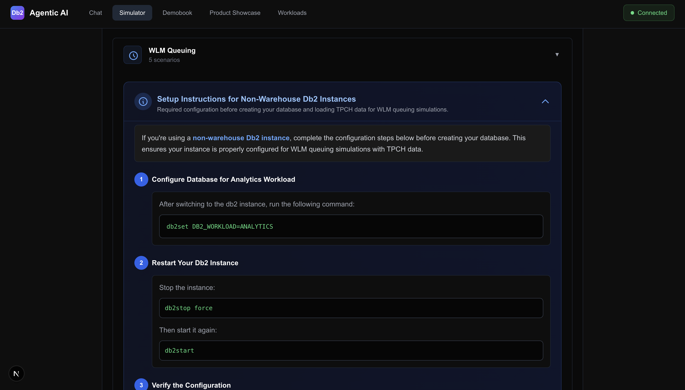

4. Scroll down to find the **Sort Memory** simulator section and click **Run Scenario**.

   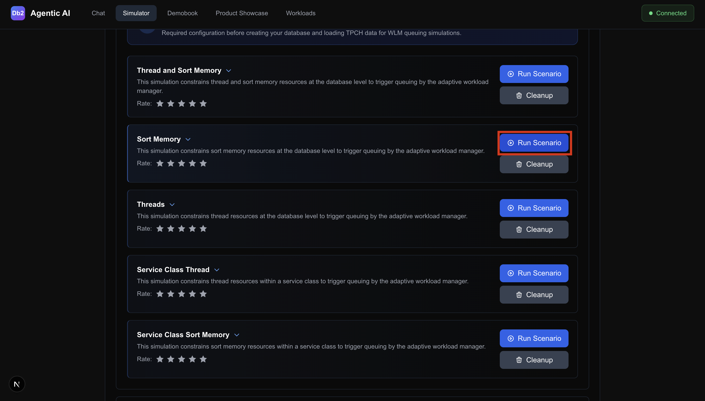

5. Enter `TPCH1` as the schema name and click **Run Simulation**.

   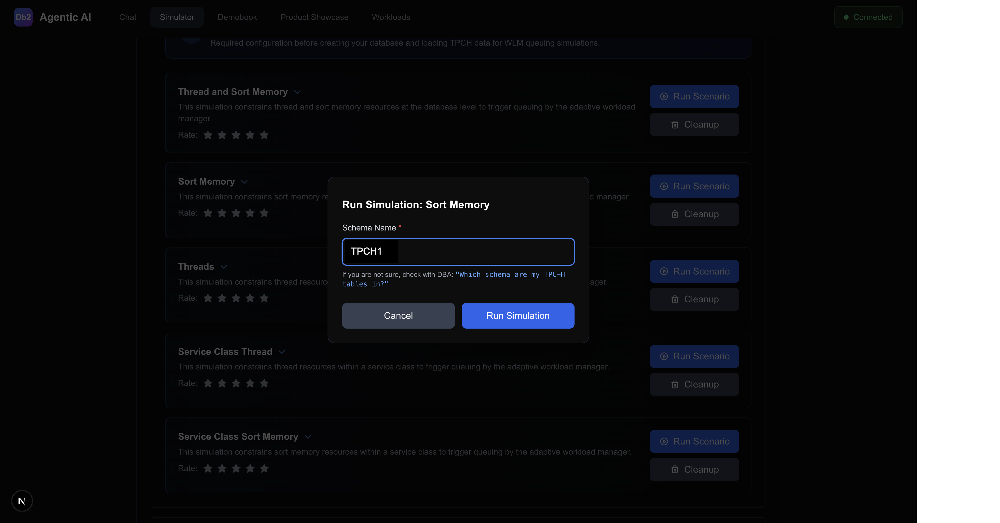

6. Monitor the logs below the simulator. Once the logs show that queuing has started, you can proceed to Genius Hub.

   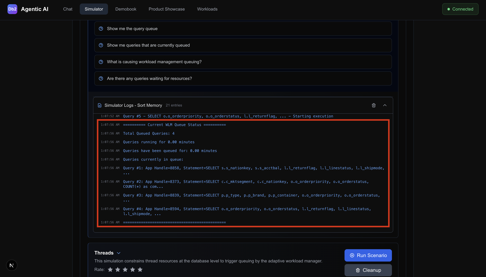

---

<h3 style="padding-left:14px; border-left:5px solid #EF9F27;">Step 1 — Navigate to the Monitor Tab</h3>

In the Genius Hub left-hand navigation menu, locate and click **Monitor**.

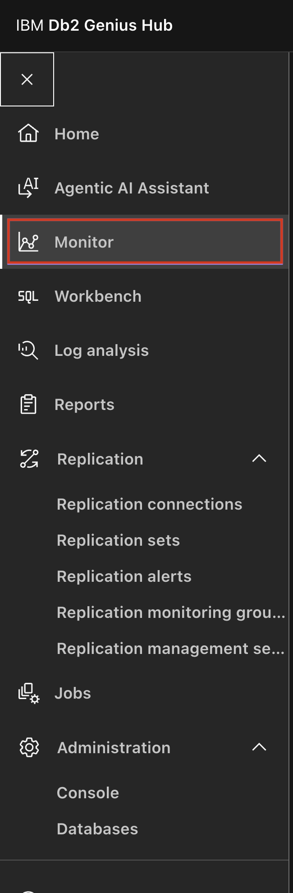

---

<h3 style="padding-left:14px; border-left:5px solid #EF9F27;">Step 2 — Select the Database and Observe Queued Queries</h3>

1. On the Monitor page, click the **Database** dropdown at the top left and select the database you want to investigate (`demo_col`).

   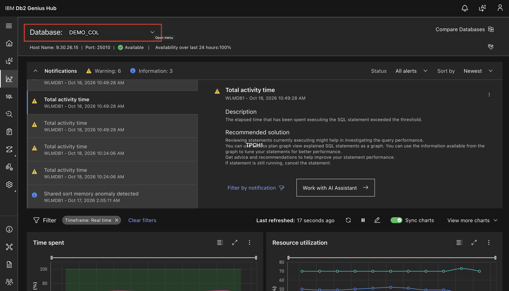

2. Scroll down to the tabbed section and click the **In-flight executions** tab to see the currently running queries.

   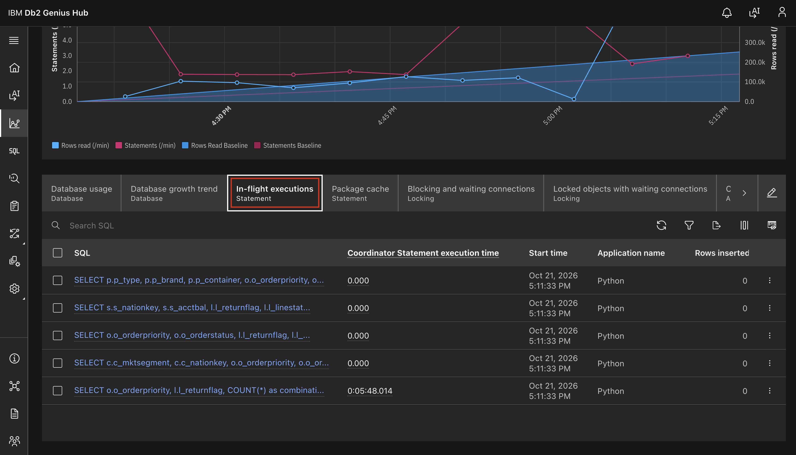

3. Inspect the **Activity state** column. You will see multiple queries with a state of **QUEUED** and non-zero WLM queue time values. They are being held by WLM admission control and are not executing.

   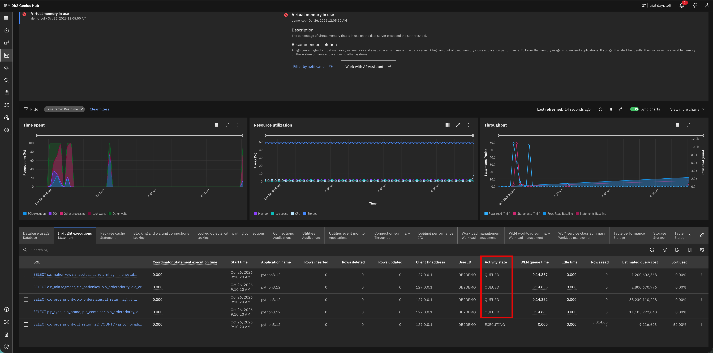

---

<h3 style="padding-left:14px; border-left:5px solid #EF9F27;">Step 3 — Open the Agentic AI Assistant</h3>

Click the **Agentic AI Assistant** icon in the top-right corner of the Genius Hub toolbar. The assistant opens.

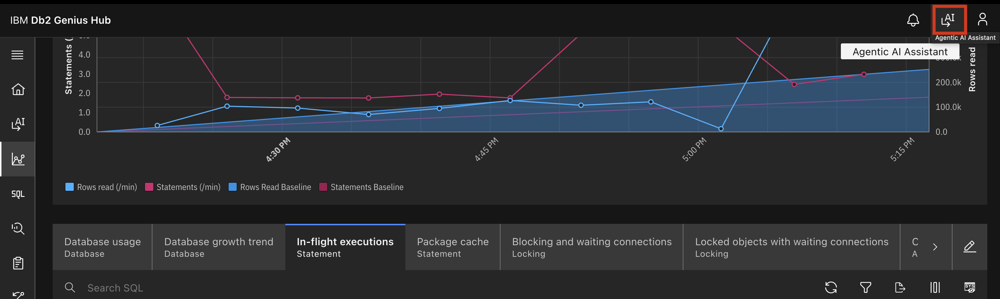

---

<h3 style="padding-left:14px; border-left:5px solid #EF9F27;">Step 4 — Select the Database in the AI Assistant</h3>

Click the **Choose Database** dropdown at the bottom of the chat window and select the database you want to investigate (`demo_col`). This scopes all AI analysis and actions to that database.

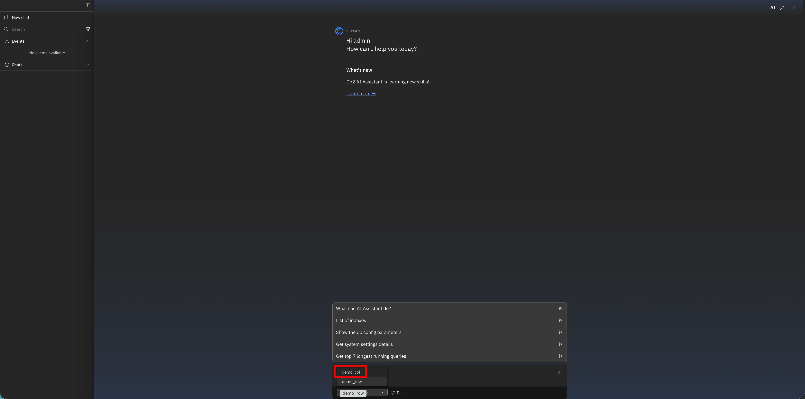

---

<h3 style="padding-left:14px; border-left:5px solid #EF9F27;">Step 5 — Ask Why Queries Are Queuing</h3>

In the chat input box, ask:

```
Why are the queries in queue?
```

The assistant autonomously runs its investigation. Observe the **Todo List** as it works through each step: triaging the issue, identifying the domain, and delivering a root cause with evidence.

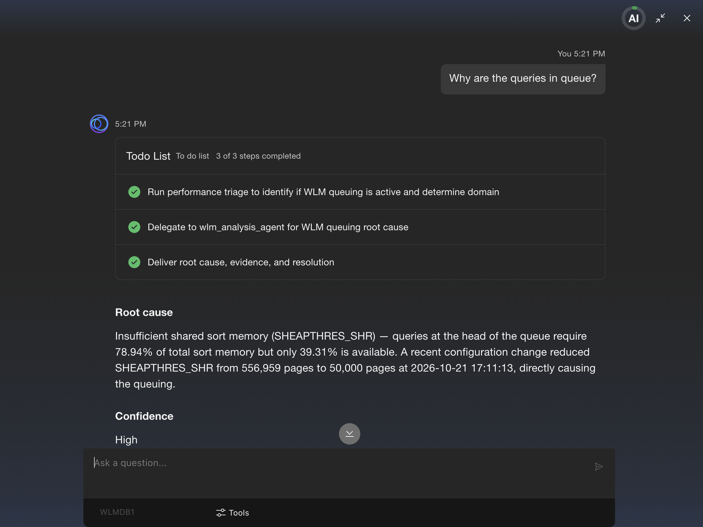

---

<h3 style="padding-left:14px; border-left:5px solid #EF9F27;">Step 6 — Review the Root Cause and Resolution Steps</h3>

1. Scroll down in the response to review the **root cause**. The assistant identifies the specific resource constraint causing queuing, along with a confidence rating and supporting evidence.

2. Continue scrolling to see the **Resolution** steps, including immediate remediation actions such as reverting a configuration change or cancelling a blocking query, and long-term recommendations.

   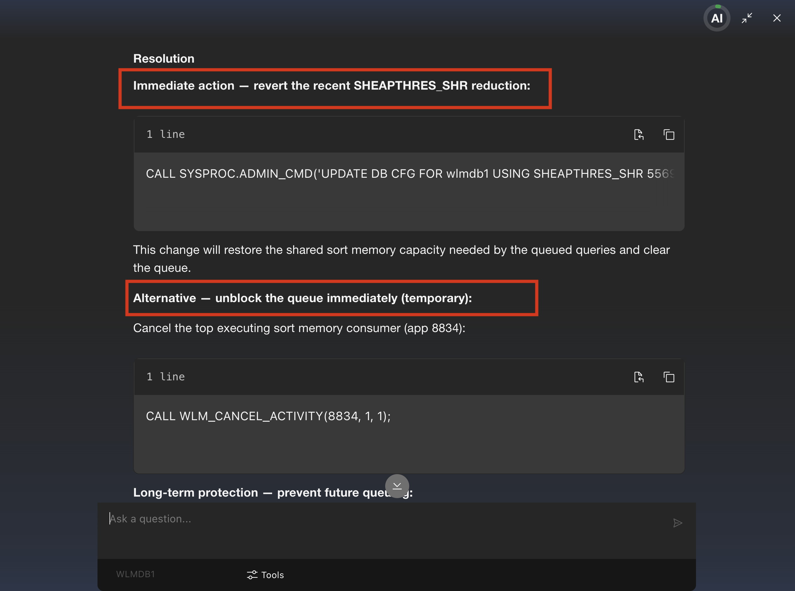

---

<h3 style="padding-left:14px; border-left:5px solid #EF9F27;">Step 7 — Apply the Configuration Change and Approve</h3>

1. In the chat input, ask the assistant to revert the configuration change:

   ```
   Revert SHEAPTHRES_SHR to its previous value
   ```

2. The assistant presents a **Database Configuration Update Request** showing the parameter (`SHEAPTHRES_SHR`), the new value (`556959`), the current value (`50000`), and the exact SQL command to be executed. Review the details carefully.

   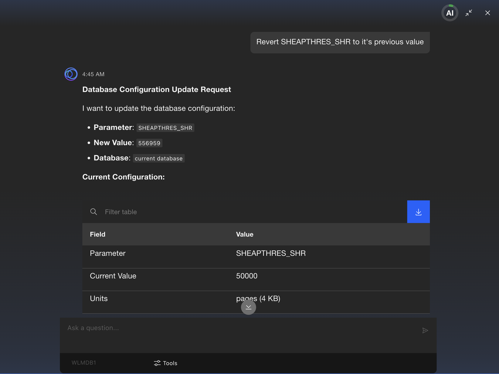

3. When satisfied, click **Approve** to authorize the change.

   > **ℹ️ Note:** Explicit human approval is required before any database configuration change is applied, ensuring you remain in full control.

   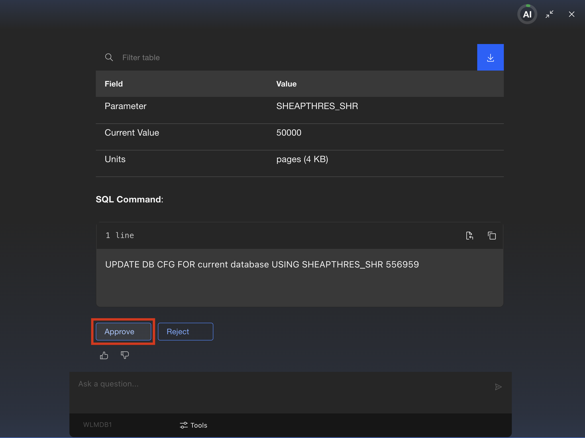

---

<h3 style="padding-left:14px; border-left:5px solid #EF9F27;">Step 8 — Verify the Configuration Was Updated and Queuing Is Resolved</h3>

1. After approving, verify that the response confirms the configuration change was successfully applied and is now in effect.

   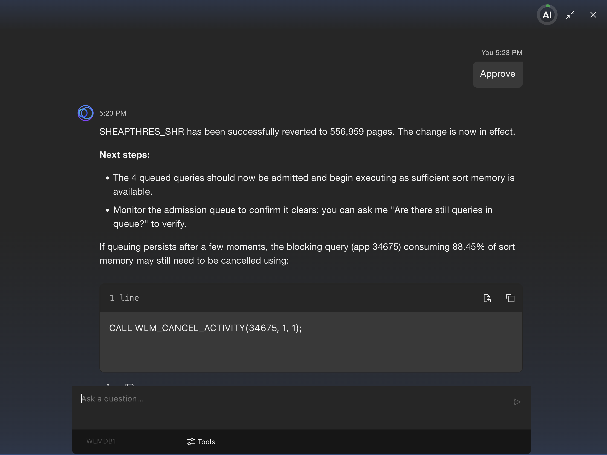

2. Ask the assistant to confirm whether the queuing issue is now resolved:

   ```
   Check if queuing issue is resolved?
   ```

   Verify that the response confirms the admission queue is now empty and all previously queued queries have been admitted.

   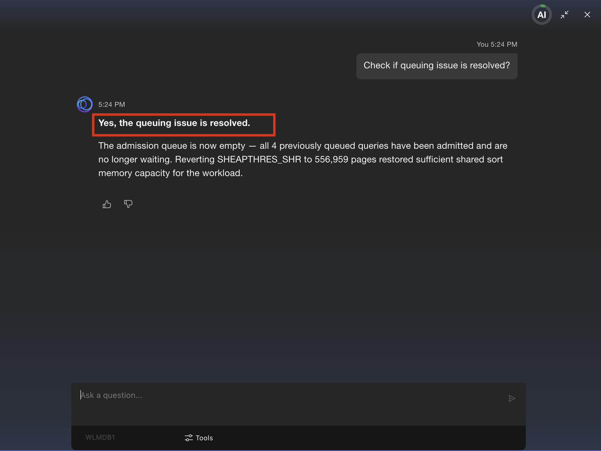

---

<h3 style="padding-left:14px; border-left:5px solid #EF9F27;">Step 9 — Check In-Flight Executions Again</h3>

1. Close the AI Assistant by clicking the **X** in the top right of the assistant panel, then return to the **Monitor** tab and click the **In-flight executions** tab again.

2. Check the **Activity state** column. All queries should now be in an **EXECUTING** state.

   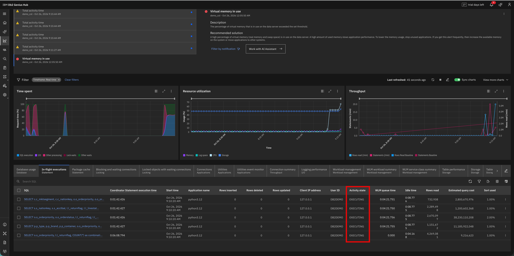

---

<h3 style="padding-left:14px; border-left:5px solid #EF9F27;">Step 10 — Stop the Scenario</h3>

Return to the Agentic AI Simulator at `http://localhost:3000`, scroll to the **Sort Memory** simulator section, and click **Clean Up** to stop the scenario. When prompted for a schema name, enter `TPCH1` in upper case, then click **Run Cleanup**.

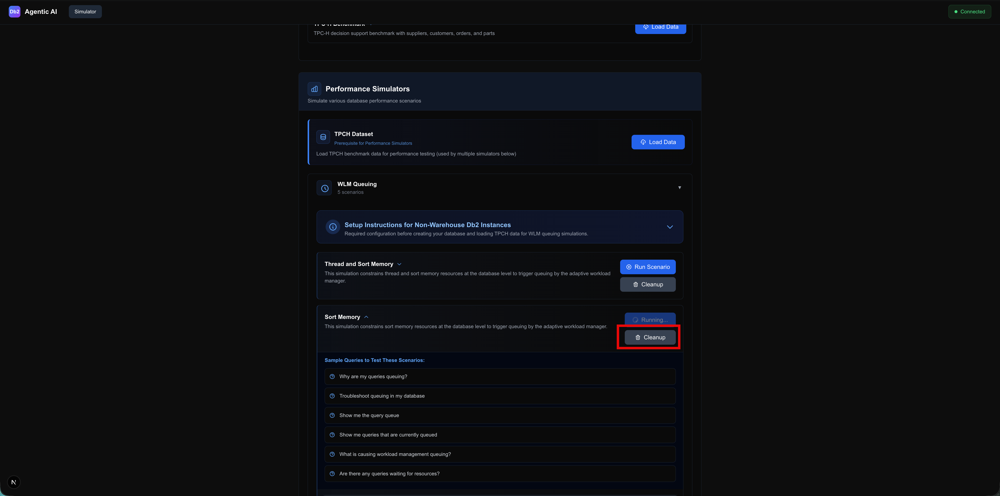

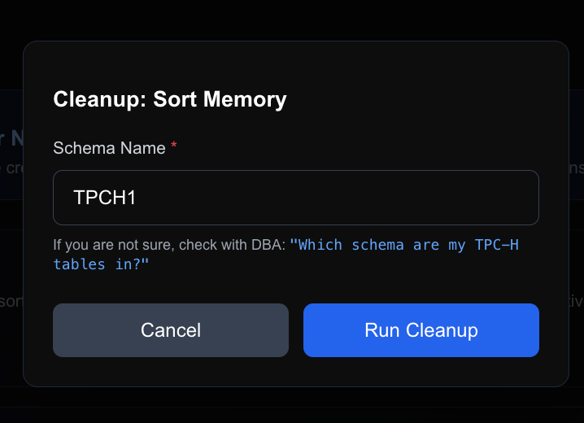

> ✅ **Task complete.** You have successfully diagnosed and resolved WLM queuing using the Agentic AI Assistant in IBM Db2 Genius Hub.

| Action | What You Did |
|---|---|
| **Observed the issue** | Used Monitor → In-flight executions to identify queries stuck in QUEUED state with growing WLM queue times |
| **Engaged the AI assistant** | Opened the Agentic AI Assistant, selected the database, and asked why queries were queuing |
| **Identified root cause** | The assistant diagnosed the specific resource constraint causing WLM to hold queries, including the configuration change responsible |
| **Applied the fix** | Asked the assistant to revert `SHEAPTHRES_SHR` to its previous value; reviewed and approved the configuration change |
| **Verified resolution** | Confirmed the configuration was updated, then returned to Monitor to verify all queries moved to EXECUTING state |

---

🎯 **TechXchange Quick Path — Step 7 of 8:** **[← Space Management with AI](05-01-space-management.md)** &nbsp;&nbsp;|&nbsp;&nbsp; **[→ Text2SQL](05-03-text2sql.md)**
