<h1 style="padding-left:16px; border-left:8px solid #378ADD;">Text2SQL — Natural Language to SQL</h1>

Use the Db2 Genius Hub AI assistant to turn plain-English questions into production-ready Db2 SQL queries. No SQL knowledge is required.

**The task.** Load the Cricket Statistics dataset, switch the assistant to **Generate SQL** mode, and ask one complex analytical question about the top run-scorers in three cricket formats. Review the SQL the agent builds, open it in the SQL Workbench, and run it.

**The story.** The question needs data from several tables, a ranking, and a comparison against country averages. Writing that by hand means finding the right tables and columns first. Instead, the assistant works out a plan, reads the schema, tells you about any gaps it finds, and hands you the finished query.

> **ℹ️ Note:** In Generate SQL mode the assistant writes and explains the SQL but does **not** run it. You decide when to run it, from the SQL Workbench.

---

<h3 style="padding-left:14px; border-left:5px solid #EF9F27;">Step 0 — Connect to the Database and Load the Cricket Statistics Dataset</h3>

Before you ask any questions, connect the simulator to the database and load the cricket dataset into Db2. Text2SQL needs tables to read.

1. Open the Agentic AI Simulator. It runs on the lab VM, so open it in **Firefox inside the Guacamole desktop**, not in a browser on your own laptop.

   1. In the Guacamole desktop, switch to **Firefox**. If you cannot see it, click **Activities** (top-left corner) and click **Firefox** in the dash.
   2. Click the **+** button in the Firefox tab bar to open a new tab.
   3. In the address bar, type `http://localhost:3000` and press **Enter**.

   > **ℹ️ Tip:** Keep the Lab Guide in one tab and the simulator in another, and click the tabs to switch between them.

2. Connect the simulator to the `demo_col` database. Click **Connect DB** in the top-right corner.

   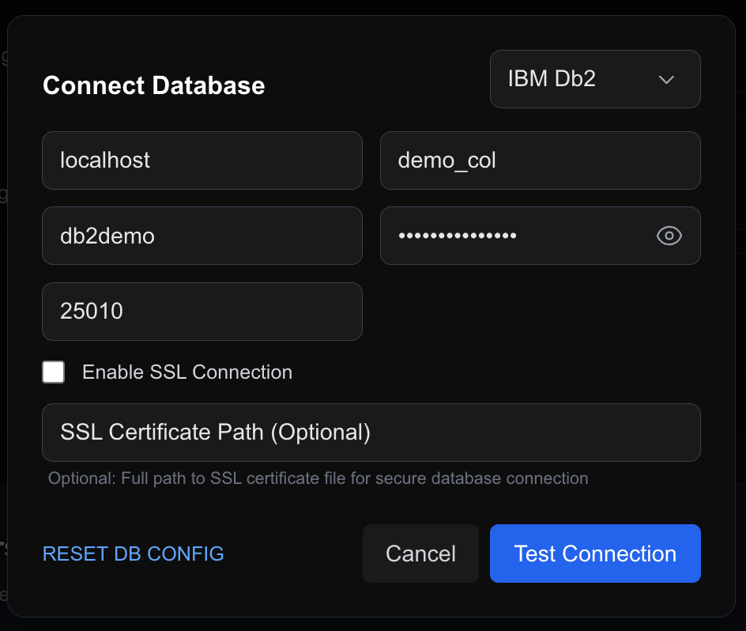

3. In the **Connect Database** window, enter these details:

   | Field | Value |
   |---|---|
   | Host | `localhost` |
   | Database | `demo_col` |
   | User | `db2demo` |
   | Password | `Db2ghPassw0rd#1` |
   | Port | `25010` |

   Leave **Enable SSL Connection** unchecked.

4. Click **Test Connection**. When the connection works, a green **Connected** badge appears at the top right. Do not continue until it is green.

   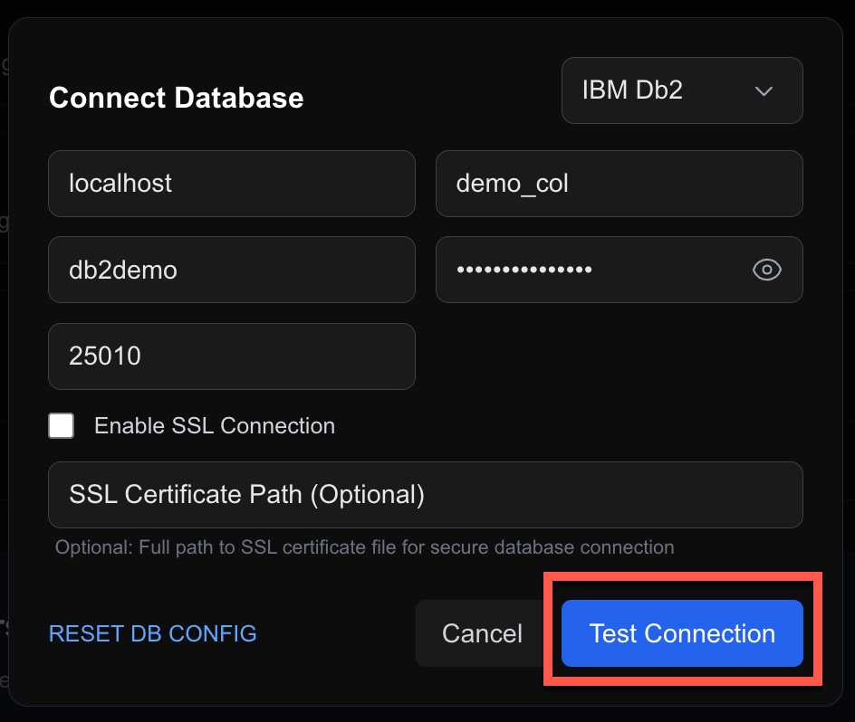

5. Click the **Simulator** tab **(b)**. Check that the green **Connected** badge **(a)** is showing. Data can only be loaded when it is green.

2. Under the **Text2SQL — Natural Language to SQL** card, three datasets are available:

   | Dataset | What it contains |
   |---|---|
   | **Cricket Statistics (c)** | Batting, bowling, and fielding records. This is the dataset used in this exercise. |
   | **Supply Chain Data (d)** | Products, inventory, orders, and shipments. |
   | **TPC-H Benchmark (e)** | Suppliers, customers, orders, and parts, for complex analytical queries. |

3. Click **Load Data (f)** next to **Cricket Statistics**.

   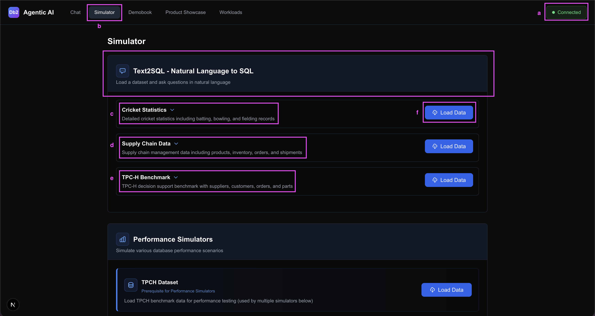

4. Wait until the button changes to a green **Loaded** badge **(a)** with a **Reload Data** button next to it. Use **Reload Data** at any time to refresh the tables.

5. Expand the dataset card to see **Sample Queries to Test This Dataset**. The **Copy query** icon **(b)** on each row copies that question to your clipboard so you can paste it into the chat.

   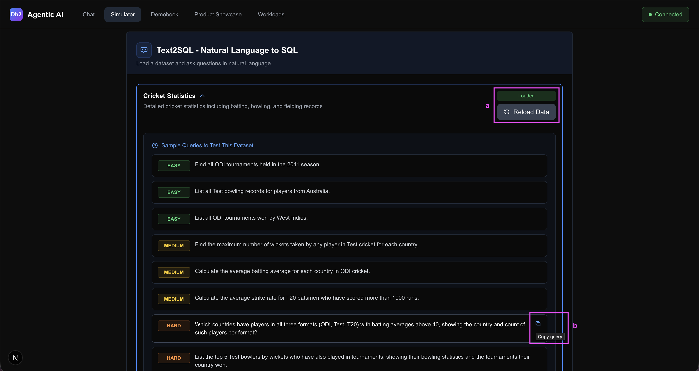

---

<h3 style="padding-left:14px; border-left:5px solid #EF9F27;">Step 1 — Open the AI Assistant and Select the Generate SQL Tool</h3>

Open the Agentic AI Assistant in Genius Hub, the same way as in the Space Management exercise. Before you ask a question, tell the assistant which tool to use.

1. In the toolbar at the bottom of the assistant, click the **Tools** button **(a)**. It sits next to the database selector.

2. In the tool picker, choose **Generate SQL (b)**. The option is labelled *"Agent does not execute code"*.

   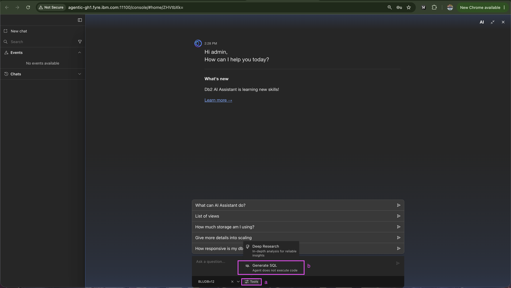

---

<h3 style="padding-left:14px; border-left:5px solid #EF9F27;">Step 2 — Confirm Text to SQL Mode Is Active</h3>

- **Confirmation message.** The chat shows *"Text to SQL mode has been activated."* The assistant is ready to turn your questions into SQL.
- **Generate SQL chip.** The active tool now shows as a chip (`Generate SQL ×`) in the toolbar. Click the `×` at any time to return to general assistant mode.

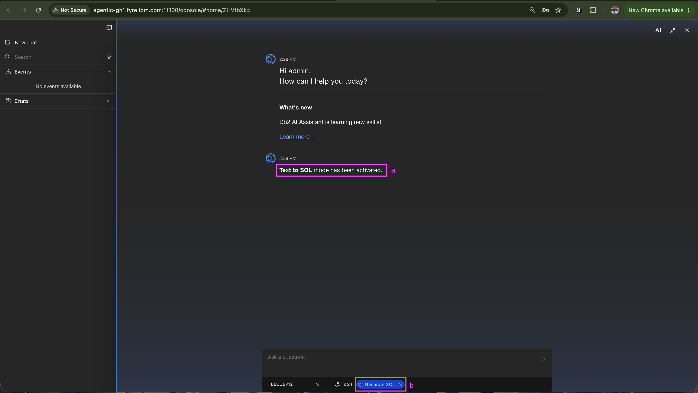

---

<h3 style="padding-left:14px; border-left:5px solid #EF9F27;">Step 3 — Ask a Complex Question and Watch the Agent Plan</h3>

Paste the question below into the chat input and send it.

**You ask:**

```
For the top 5 run-scorers in each format (ODI, Test, T20), analyze their consistency by calculating the ratio of centuries to matches played. Show player name, country, format, total runs, matches, centuries, consistency ratio, and compare this ratio to the average consistency ratio of all players from their country in that format who have played at least 50 matches. Identify which players exceed their country's average.
```

The assistant builds a structured **Todo List** and starts working through it, one step at a time.

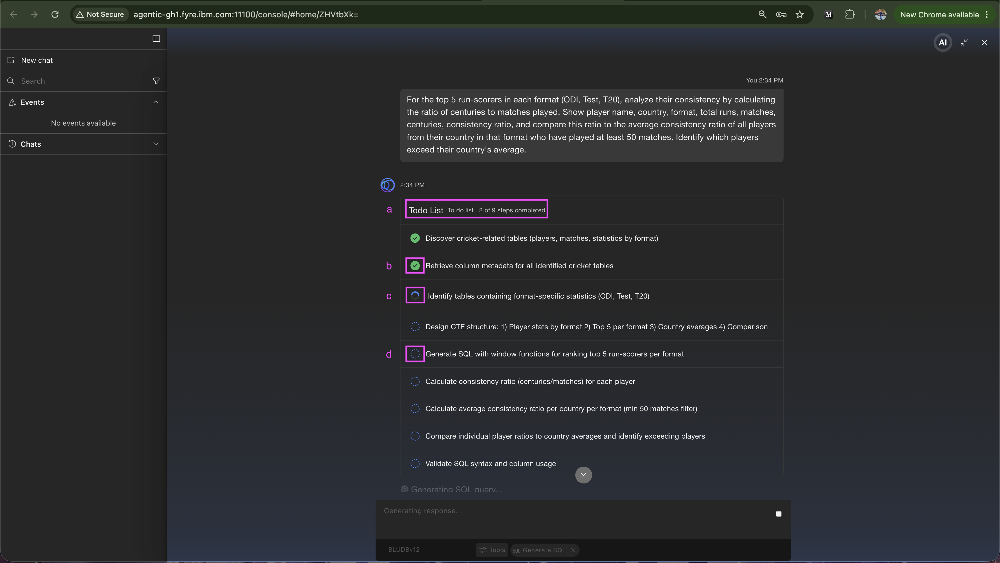

- **Todo List header (a).** Shows how many steps are complete. Here, 2 of 9.
- **Completed step (b).** A green check marks a finished step. Step 2, *Retrieve column metadata for all identified cricket tables*, is done.
- **In-progress step (c).** A spinning icon marks the step that is running now.
- **Queued steps (d).** The remaining steps wait their turn. Each step's output feeds the next one.

---

<h3 style="padding-left:14px; border-left:5px solid #EF9F27;">Step 4 — Follow the Agent's Schema Analysis</h3>

At 4 of 9 steps, the agent stops to look at the schema more closely. It tells you what it found: the batting tables do not have a country column. It then explains how it plans to deal with that before it writes any SQL.

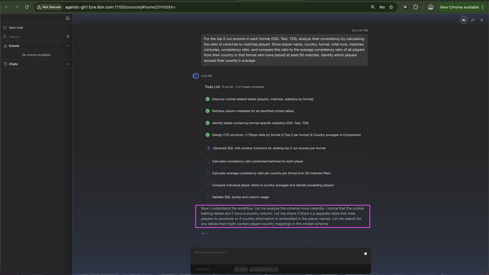

- **Reasoning note (a).** *"I notice that the cricket batting tables don't have a country column. Let me check if there's a separate table that links players to countries…"* The agent adapts its plan to the schema it finds, instead of guessing.

---

<h3 style="padding-left:14px; border-left:5px solid #EF9F27;">Step 5 — Review the Generated SQL</h3>

When all 9 steps are complete, the assistant shows the SQL in a highlighted code block with a note and a short explanation.

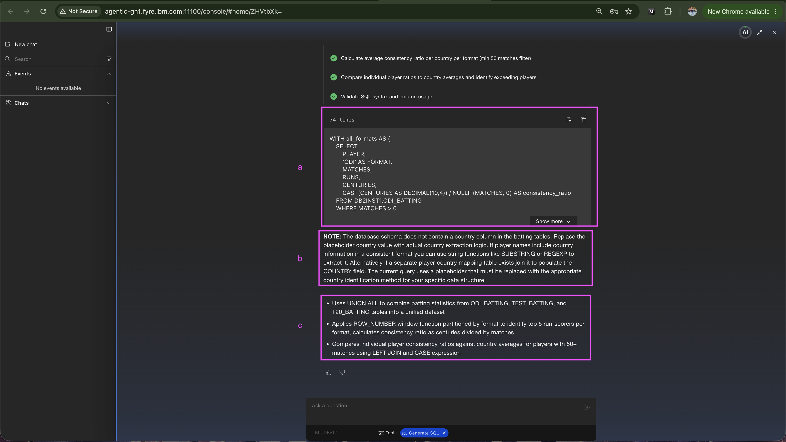

- **SQL code block (a).** A 74-line Db2 query. It starts with a `WITH all_formats AS (…)` common table expression that combines the ODI, Test, and T20 batting tables. The toolbar has copy and open-in-workbench icons.
- **NOTE (b).** The assistant says plainly that the batting tables have no country column. Read this before you run the query so you know what to expect.
- **Query logic summary (c).** Three bullets explain the approach: `UNION ALL` merges the three batting tables, `ROW_NUMBER()` partitioned by format ranks the top 5 run-scorers, and a `LEFT JOIN` with a `CASE` expression compares each player to the country average.

---

<h3 style="padding-left:14px; border-left:5px solid #EF9F27;">Step 6 — Expand the Code Block</h3>

The code block shows a short preview. Click **Show more (a)** to see the whole query.

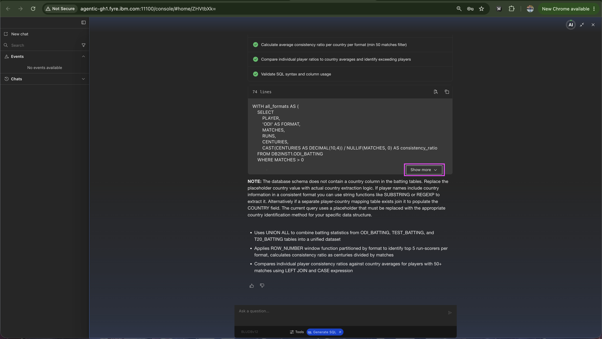

---

<h3 style="padding-left:14px; border-left:5px solid #EF9F27;">Step 7 — Read the Full Query</h3>

With the block expanded, you can read all 74 lines. The first section selects from `DB2DEMO.ODI_BATTING`, the second from `DB2DEMO.TEST_BATTING`, and the third from `DB2DEMO.T20_BATTING`.

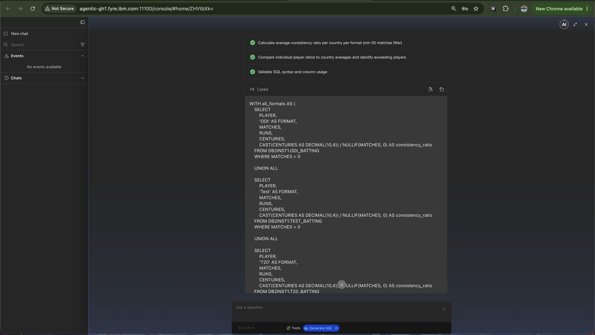

---

<h3 style="padding-left:14px; border-left:5px solid #EF9F27;">Step 8 — Open the Query in the SQL Workbench</h3>

When you are happy with the SQL, click **Open in workbench (a)**, the first icon in the code block toolbar. The SQL Workbench opens in a new tab with the query already loaded. You do not need to copy and paste.


---

<h3 style="padding-left:14px; border-left:5px solid #EF9F27;">Step 9 — Or Copy the SQL to the Clipboard</h3>

To use the SQL somewhere else, such as another SQL editor, notebook, or IDE, click **Copy to clipboard (a)**, the second icon. This copies the full 74-line query so you can change it before you run it.

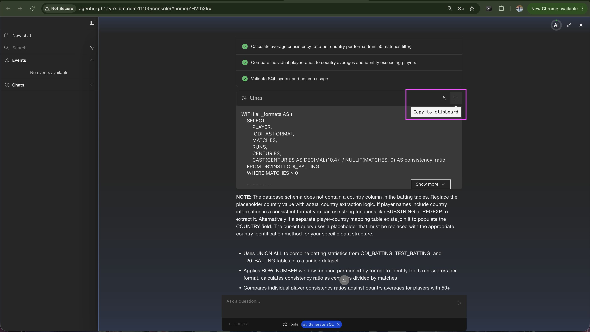

---

<h3 style="padding-left:14px; border-left:5px solid #EF9F27;">Step 10 — Check the Query in the Workbench</h3>

The SQL Workbench shows the generated query in the editor, and the AI assistant panel stays open on the right.

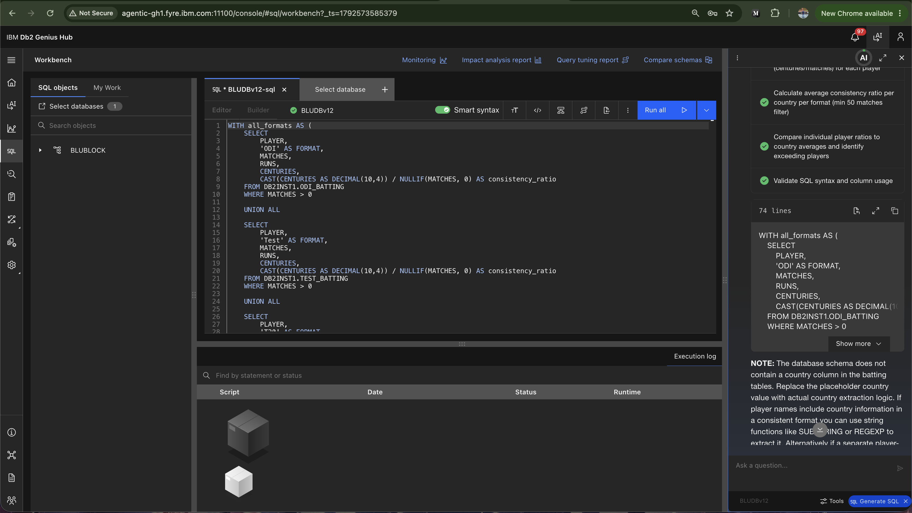

- **SQL editor (a).** The complete 74-line query, with syntax highlighting. Check that the database selector shows the database you expect.
- **AI Assistant panel (b).** The chat, including the agent's notes and explanation, stays visible so you can compare it with the query while you edit.

---

<h3 style="padding-left:14px; border-left:5px solid #EF9F27;">Step 11 — Run the Query</h3>

Click the arrow **(a)** next to **Run all** to see the run options. For a single statement like this one, **Run all** and **Run selected** give the same result.

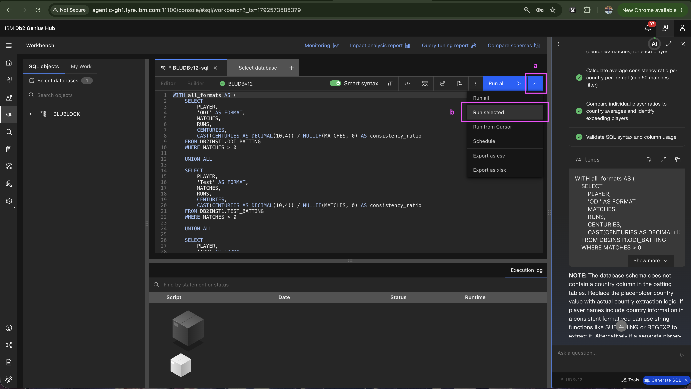

- **Run selected (b).** Runs only the highlighted text.
- **Other options.** **Run from Cursor** runs from the cursor position downwards. **Schedule** runs the statement later. **Export as csv** and **Export as xlsx** save the results.

---

<h3 style="padding-left:14px; border-left:5px solid #EF9F27;">Step 12 — Review the Results</h3>

The result panel opens below the editor with the 15 rows the query returned. The columns are `PLAYER`, `COUNTRY`, `FORMAT`, `TOTAL_RUNS`, `MATCHES`, `CENTURIES`, and `CONSISTENCY_RATIO`.

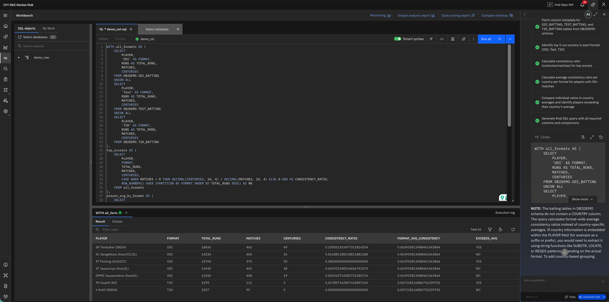

- **Result panel (a).** Shows *Total: 15* and a green success indicator. For example: *SR Tendulkar (INDIA), 18,426 ODI runs, 463 matches, 49 centuries*.

> **ℹ️ Note:** The `COUNTRY` column shows `<country>` placeholder values. This is expected. The assistant told you in Step 5 that the batting tables do not contain a country column.

---

<h3 style="padding-left:14px; border-left:5px solid #EF9F27;">Step 13 — If the Agent Asks Which Schema to Use</h3>

If the same table name exists in more than one schema, the agent pauses and asks which one you mean. It does not guess.

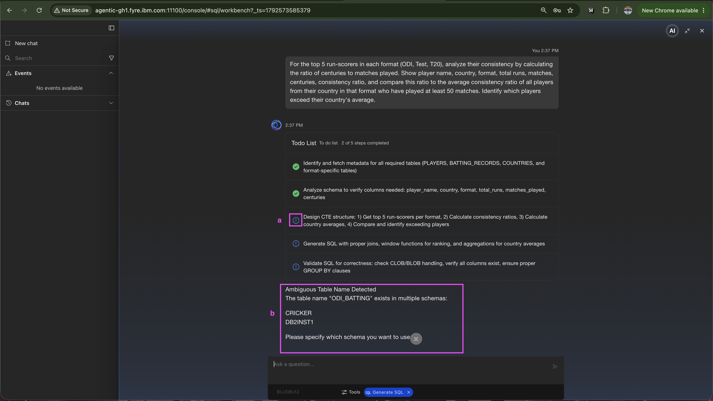

- **Paused step (a).** The *Design CTE structure* step shows a spinning icon. The agent has stopped because it cannot resolve the ambiguity on its own.
- **Ambiguous Table Name Detected (b).** *"The table name 'ODI_BATTING' exists in multiple schemas: CRICKER, DB2DEMO. Please specify which schema you want to use."*

> **ℹ️ Note:** This prompt only appears when the same table name exists in more than one accessible schema. If your database has a single schema, the step is skipped.

---

<h3 style="padding-left:14px; border-left:5px solid #EF9F27;">Step 14 — Answer with the Schema</h3>

Type your answer in the chat and send it.

**You answer:**

```
I want to use DB2DEMO schema.
```

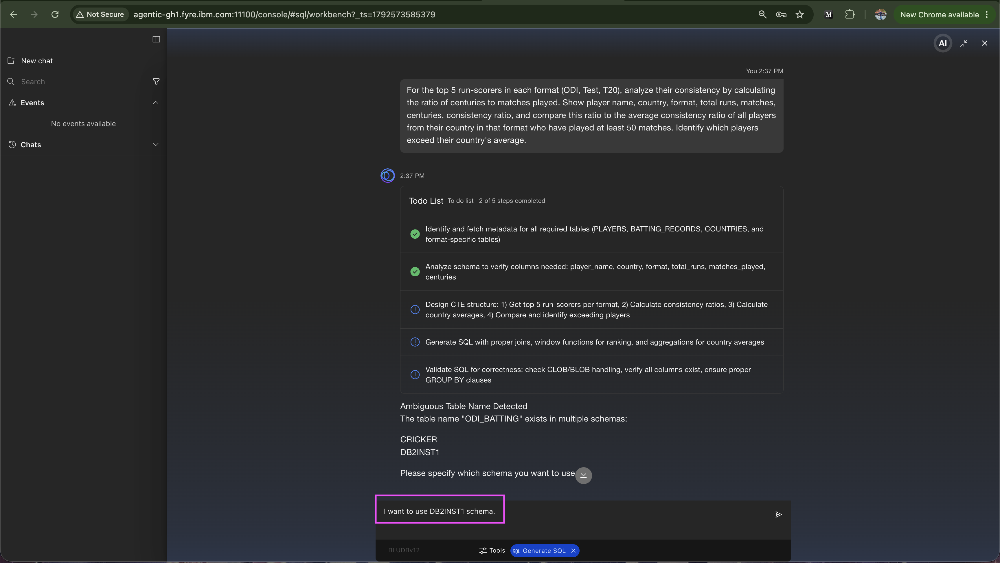

- **Schema selection (a).** The agent carries on with the rest of its Todo List. It adds the `DB2DEMO.` prefix to every table (for example `DB2DEMO.ODI_BATTING`) and produces a fully qualified SQL statement that is ready to run.

> ✅ **Task complete.** You have used the Agentic AI Assistant in IBM Db2 Genius Hub to turn a complex plain-English question into working Db2 SQL.

| Action | What You Did |
|---|---|
| **Loaded the data** | Loaded the Cricket Statistics dataset from the Simulator tab |
| **Switched mode** | Selected the **Generate SQL** tool in the AI assistant |
| **Asked the question** | Asked for the consistency of the top run-scorers in ODI, Test, and T20 |
| **Reviewed the plan** | Followed the agent's Todo List, its schema analysis, and the gap it reported |
| **Used the SQL** | Opened the query in the SQL Workbench, ran it, and reviewed the results |

---

<h3 style="padding-left:14px; border-left:5px solid #EF9F27;">More Questions to Try</h3>

If you finish early, paste any of these into the Text2SQL chat with the Cricket Statistics dataset loaded. Each one tests a different analytical skill.

**1. Multi-format country analysis**

```
Which countries have players in all three formats (ODI, Test, T20) with batting averages above 40, showing the country and count of such players per format?
```

**2. Top bowlers with tournament history**

```
List the top 5 Test bowlers by wickets who have also played in tournaments, showing their bowling statistics and the tournaments their country won.
```

**3. Centuries-to-half-centuries ratio ranking**

```
Calculate the ratio of centuries to half-centuries for ODI batsmen who have scored more than 8000 runs, and rank them by this ratio in descending order.
```

---

> ✅ **This is the end of the lab.**

---

<h2 style="padding-left:14px; border-left:6px solid #1D9E75;">Summary</h2>

In this lab, you:

| Section | What You Did |
|---|---|
| **Setup** | Connected to the lab VM, started Genius Hub services, and configured the environment |
| **Basics** | Explored the Genius Hub UI, configured event monitors, and set up AI configuration |
| **SQL Workbench** | Created tables, ran queries, used Visual Explain, and applied AI Query Tuner recommendations |
| **Monitoring** | Analyzed CPU anomalies, generated reports, used the Agentic AI Assistant, and configured alerts |
| **Agentic AI Simulator** | Used the AI assistant to find and reclaim wasted tablespace space with approval at each step, then triggered a WLM sort memory queuing scenario, used the AI assistant to diagnose the root cause, approved a configuration revert, and verified all queries returned to EXECUTING state. Finally, loaded the Cricket Statistics dataset, used Generate SQL mode to turn a complex plain-English question into Db2 SQL, and ran it in the SQL Workbench |

---

🎯 **TechXchange Quick Path — Step 8 of 8:** **[← Text2SQL](05-02-wlm-queuing.md)** &nbsp;&nbsp;|&nbsp;&nbsp; ✅ End of the Quick Path

**[← Return to Introduction](00-introduction.md)**
