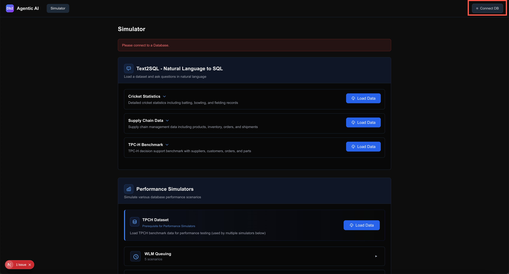
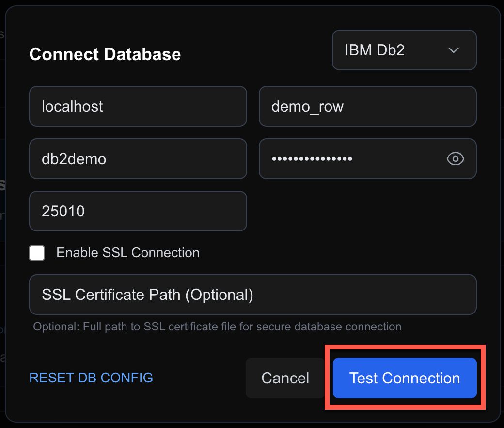

<h1 style="padding-left:16px; border-left:8px solid #378ADD;">Query Tuning with the AI Assistant</h1>

Take a slow TPC-H query, ask the Db2 Genius Hub AI assistant to tune it, apply the index it recommends, and watch the same query go from about 30 seconds to under a millisecond. Then clean up so the exercise can be repeated.

**The task.** Open the SQL Workbench, run a slow correlated subquery, ask the assistant to tune it, apply the recommended index, and confirm the speedup. Then drop the index to leave the database in its original state.

**The story.** The query looks up the most recent line item for each of 50 suppliers. Without an index, Db2 scans the `LINEITEM` table once per supplier — 50 full scans. The assistant identifies the bottleneck, recommends a composite index that covers the `WHERE`, `ORDER BY`, and `SELECT` columns, and explains why it helps. After you create the index, the same query returns in under a millisecond.

---

<h3 style="padding-left:14px; border-left:5px solid #EF9F27;">Step 0 — Connect the Simulator to demo_row</h3>

The TPC-H data is already loaded in `demo_row`. You only need to connect the simulator so it knows which database to use.

1. Open the Agentic AI Simulator at `http://localhost:3000` in Firefox inside the Guacamole desktop.

2. Click **Connect DB** in the top-right corner.

   

3. In the **Connect Database** window, enter these details:

   | Field | Value |
   |---|---|
   | Host | `localhost` |
   | Database | `demo_row` |
   | User | `db2demo` |
   | Password | `Db2ghPassw0rd#1` |
   | Port | `25010` |

   Leave **Enable SSL Connection** unchecked.

4. Click **Test Connection**. Wait for the green **Connected** badge. Do not continue until it is green.

   

5. You do not need to load data. The `TPCH1`, `TPCH2` and `TPCH3` schemas are already loaded in `demo_row` — skip **Load Data**.

---

<h3 style="padding-left:14px; border-left:5px solid #EF9F27;">Step 1 — Confirm No Index on L_SUPPKEY Exists</h3>

Some TPC-H loaders create foreign-key indexes. If an index already starts with `L_SUPPKEY`, the query will run fast and the assistant will have nothing to recommend. Check first.

In the Genius Hub **SQL Workbench**, run:

```sql
SELECT INDSCHEMA, INDNAME, COLNAMES
FROM   SYSCAT.INDEXES
WHERE  TABSCHEMA = 'TPCH1'
  AND  TABNAME   = 'LINEITEM'
  AND  COLNAMES LIKE '+L_SUPPKEY%';
```

> **Expected:** no rows returned. If a row is returned, go to Step 8 and drop that index first, then return here.

---

<h3 style="padding-left:14px; border-left:5px solid #EF9F27;">Step 2 — Run the Slow Query and Note the Time</h3>

This query looks up the most recent line item for each of 50 suppliers. Without an index, Db2 scans `LINEITEM` once per supplier.

In the **SQL Workbench**, run:

```sql
SELECT S.S_SUPPKEY,
       S.S_NAME,
       (SELECT L.L_EXTENDEDPRICE
        FROM   TPCH1.LINEITEM L
        WHERE  L.L_SUPPKEY = S.S_SUPPKEY
        ORDER BY L.L_SHIPDATE DESC
        FETCH FIRST 1 ROW ONLY) AS LATEST_LINE_PRICE
FROM   TPCH1.SUPPLIER S
WHERE  S.S_SUPPKEY BETWEEN 1 AND 50
ORDER BY S.S_SUPPKEY;
```

> **Expected:** 50 rows, after a noticeable wait (about 30 seconds). Write down the **Runtime** from the Execution log — you will compare it in Step 6.

> **ℹ️ Note:** If it finishes much faster or slower than you want, change the upper bound in `BETWEEN 1 AND 50` — a smaller number shortens the wait, a larger number lengthens it.

---

<h3 style="padding-left:14px; border-left:5px solid #EF9F27;">Step 3 — Ask the Assistant to Tune the Query</h3>

Open the Agentic AI Assistant in Genius Hub (click **Agentic AI Assistant** in the left menu), choose `demo_row` in the **Choose Database** field, then paste and send the prompt below. It includes the full query.

**You ask:**

```
Can you tune this query and provide optimization recommendations?

SELECT S.S_SUPPKEY,
       S.S_NAME,
       (SELECT L.L_EXTENDEDPRICE
        FROM   TPCH1.LINEITEM L
        WHERE  L.L_SUPPKEY = S.S_SUPPKEY
        ORDER BY L.L_SHIPDATE DESC
        FETCH FIRST 1 ROW ONLY) AS LATEST_LINE_PRICE
FROM   TPCH1.SUPPLIER S
WHERE  S.S_SUPPKEY BETWEEN 1 AND 50
ORDER BY S.S_SUPPKEY
```

> **Expected:** the assistant replies with:
> - **Performance impact:** the correlated subquery runs once per supplier row (50 times), causing repeated scans of `TPCH1.LINEITEM`.
> - **Index recommendation:** a composite index on `LINEITEM`, the `CREATE INDEX` statement, an explanation of why it helps, and an estimated improvement.
> - **Statistics update:** `RUNSTATS` commands to run before creating the index.

---

<h3 style="padding-left:14px; border-left:5px solid #EF9F27;">Step 4 — Review the Recommendation</h3>

Scroll through the reply. The index the assistant recommends looks like this:

```sql
CREATE INDEX IDX2611041339480 ON "TPCH1"."LINEITEM"
  ("L_SUPPKEY" ASC, "L_SHIPDATE" DESC, "L_EXTENDEDPRICE" ASC)
  ALLOW REVERSE SCANS
  COLLECT SAMPLED DETAILED STATISTICS;
```

The assistant explains that the index covers the three columns the subquery uses:

- `L_SUPPKEY` is the `WHERE` filter.
- `L_SHIPDATE` (descending) is the `ORDER BY`.
- `L_EXTENDEDPRICE` is the selected column — Db2 can read the latest price directly from the index without touching the table.

> **ℹ️ Note:** The index name contains a timestamp and is different on every run. Use the statement the assistant gives you, not the example above.

---

<h3 style="padding-left:14px; border-left:5px solid #EF9F27;">Step 5 — Create the Recommended Index</h3>

The assistant suggests refreshing statistics first. In the **SQL Workbench**, run these two statements one at a time:

```sql
CALL SYSPROC.ADMIN_CMD('RUNSTATS ON TABLE TPCH1.SUPPLIER WITH DISTRIBUTION AND DETAILED INDEXES ALL');
CALL SYSPROC.ADMIN_CMD('RUNSTATS ON TABLE TPCH1.LINEITEM WITH DISTRIBUTION AND DETAILED INDEXES ALL');
```

Then create the index. In the assistant's reply, click **Open in workbench** on the `CREATE INDEX` block. The statement opens in the SQL Workbench with your own index name. Select the statement and click **Run selected**.

> **Expected:** all three statements succeed.

> **ℹ️ Note:** The index is created in your connection's schema (`DB2DEMO`). Note the schema — you will need it in Step 8.

---

<h3 style="padding-left:14px; border-left:5px solid #EF9F27;">Step 6 — Re-Run the Query and Compare</h3>

Run the same query from Step 2 again:

```sql
SELECT S.S_SUPPKEY,
       S.S_NAME,
       (SELECT L.L_EXTENDEDPRICE
        FROM   TPCH1.LINEITEM L
        WHERE  L.L_SUPPKEY = S.S_SUPPKEY
        ORDER BY L.L_SHIPDATE DESC
        FETCH FIRST 1 ROW ONLY) AS LATEST_LINE_PRICE
FROM   TPCH1.SUPPLIER S
WHERE  S.S_SUPPKEY BETWEEN 1 AND 50
ORDER BY S.S_SUPPKEY;
```

> **Expected:** the same 50 rows, now returned in well under a second. Compare the **Runtime** with the one you noted in Step 2.

---

<h3 style="padding-left:14px; border-left:5px solid #EF9F27;">Step 7 — Confirm the Index in the Catalog</h3>

Check that the index exists before you drop it.

```sql
SELECT INDSCHEMA, INDNAME, COLNAMES
FROM   SYSCAT.INDEXES
WHERE  TABSCHEMA = 'TPCH1'
  AND  TABNAME   = 'LINEITEM'
  AND  COLNAMES LIKE '+L_SUPPKEY%';
```

> **Expected:** one row — `DB2DEMO`, the generated index name, and `+L_SUPPKEY-L_SHIPDATE+L_EXTENDEDPRICE`.

---

<h3 style="padding-left:14px; border-left:5px solid #EF9F27;">Step 8 — Clean Up: Drop the Index</h3>

Drop the index so the exercise can be run again. Substitute the index name from the Step 7 result.

```sql
DROP INDEX DB2DEMO.<index_name_from_step_7>;
```

Then refresh the statistics:

```sql
CALL SYSPROC.ADMIN_CMD('RUNSTATS ON TABLE TPCH1.LINEITEM WITH DISTRIBUTION AND DETAILED INDEXES ALL');
```

> **⚠️ Warning:** Only drop the index you created in this exercise. Indexes that enforce a primary key or unique constraint cannot be dropped with `DROP INDEX` (error SQL0669N).

---

<h3 style="padding-left:14px; border-left:5px solid #EF9F27;">Step 9 — Verify the Cleanup</h3>

Re-run the lookup from Step 1 to confirm the index is gone:

```sql
SELECT INDSCHEMA, INDNAME, COLNAMES
FROM   SYSCAT.INDEXES
WHERE  TABSCHEMA = 'TPCH1'
  AND  TABNAME   = 'LINEITEM'
  AND  COLNAMES LIKE '+L_SUPPKEY%';
```

> **Expected:** no rows. The query from Step 2 is slow again — the exercise is ready to run from Step 1.

> ✅ **Task complete.** You have used the Db2 Genius Hub AI assistant to diagnose a slow query, applied the recommended index, confirmed the speedup, and restored the database to its original state.

| Action | What You Did |
|---|---|
| **Confirmed the baseline** | Verified no index on `L_SUPPKEY` existed, then ran the slow query and noted the runtime |
| **Asked the assistant** | Pasted the query and asked for tuning recommendations |
| **Reviewed the plan** | Read the assistant's explanation of the correlated subquery bottleneck and the composite index it recommended |
| **Applied the fix** | Ran RUNSTATS, then created the index from the assistant's reply |
| **Confirmed the speedup** | Re-ran the query and compared runtimes |
| **Cleaned up** | Dropped the index and refreshed statistics so the exercise can be repeated |

---

🎯 **TechXchange Quick Path — Step 9 of 9:** **[← Text2SQL](05-03-text2sql.md)** &nbsp;&nbsp;|&nbsp;&nbsp; ✅ End of the Quick Path

**[← Return to Introduction](00-introduction.md)**
