<h1 style="padding-left:16px; border-left:8px solid #378ADD;">Agentic AI Simulator</h1>

<h2 style="padding-left:14px; border-left:6px solid #1D9E75;">Overview</h2>

The Db2 Agentic AI Simulator is a separate, as-is application provided for hands-on lab tasks. It allows you to trigger events that demonstrate how the Db2 agentic AI service detects and solves problems.

**The application includes:**

| Feature | Description |
|---|---|
| **Text2SQL** | Natural Language to SQL — load a dataset and ask questions in plain English |
| **WLM Queuing** | Constrain sort memory to trigger adaptive workload manager queuing |
| **Query Spilling** | Trigger sort spill-to-disk events |
| **Locking** | Create locking contention between sessions |
| **Space Management** | Test tablespace space management issues |
| **Blocking** | Demonstrate transaction blocking scenarios |
| **Runstats** | Run statistics collection operations |

---

<h2 style="padding-left:14px; border-left:6px solid #1D9E75;">Accessing the Simulator</h2>

Open a browser and navigate to:

```
http://localhost:3000
```

---

<h2 id="wlm-queuing" style="padding-left:14px; border-left:6px solid #1D9E75;">Sort Memory Queuing Simulation</h2>

This simulation constrains sort memory resources at the database level to trigger queuing by the adaptive workload manager.

---

<h3 style="padding-left:14px; border-left:5px solid #EF9F27;">Step 1 — Establish Database Connection</h3>

1. Click the top right icon **Connect DB** to connect to the `DEMO_COL` database.

   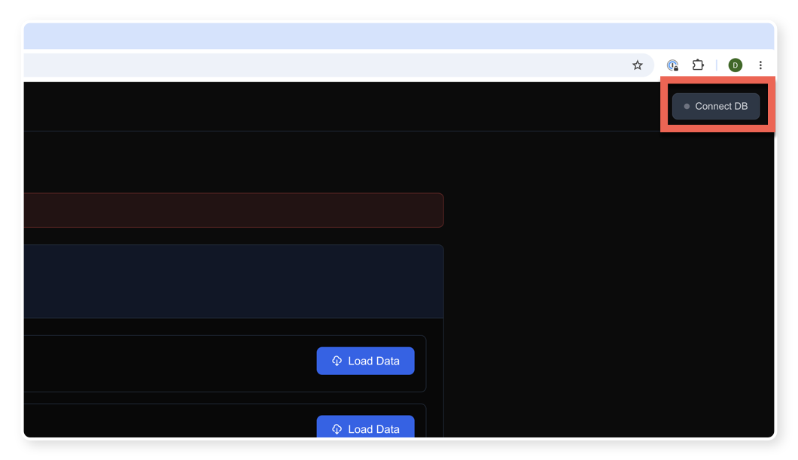

2. Enter the database credentials and click **Connect**.

   

3. Confirm the connection is active — the **Connect DB** icon turns green.

   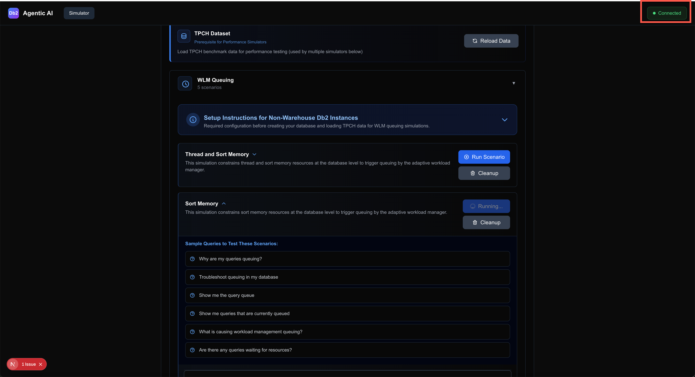

---

<h3 style="padding-left:14px; border-left:5px solid #EF9F27;">Step 2 — Load TPCH Dataset</h3>

<!-- TODO: confirm whether attendees who already loaded TPCH in the Space Management exercise can skip this step. Then replace this comment with a visible note. -->

4. In the TPCH Dataset section, click **Load Data**.

   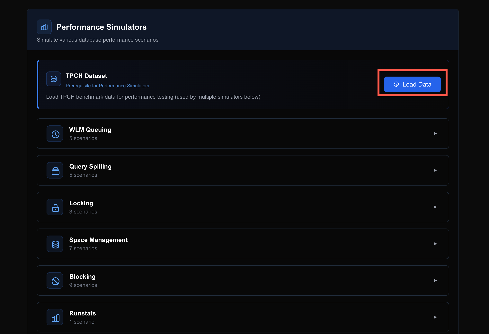

5. Select the dataset size **SF 0.1 (Medium - ~600K rows) (a)** and click **Continue (b)**.

   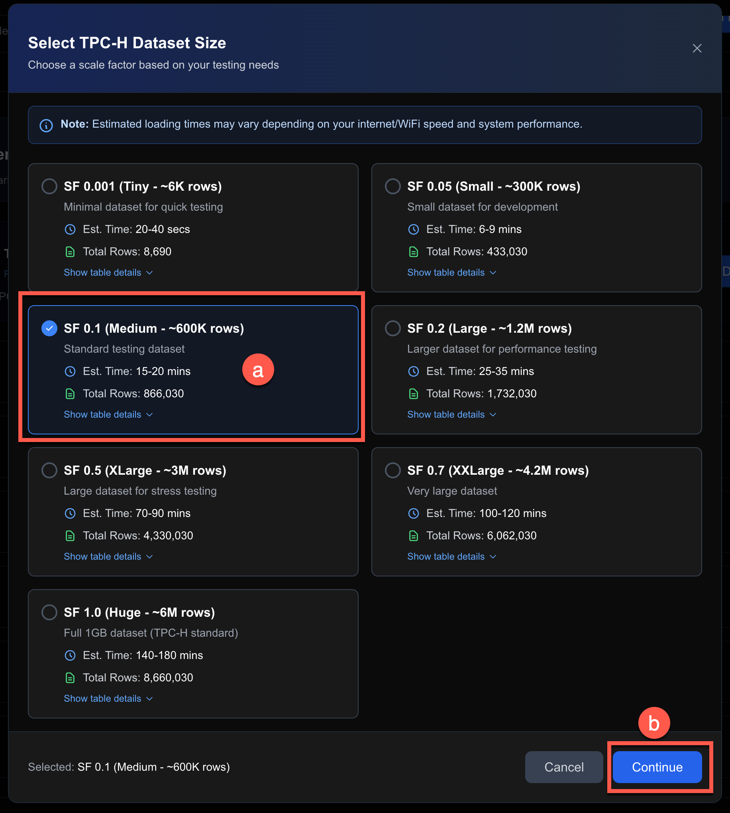

6. Enter schema `DEMO` **(a)** and click **Load Data (b)**.

   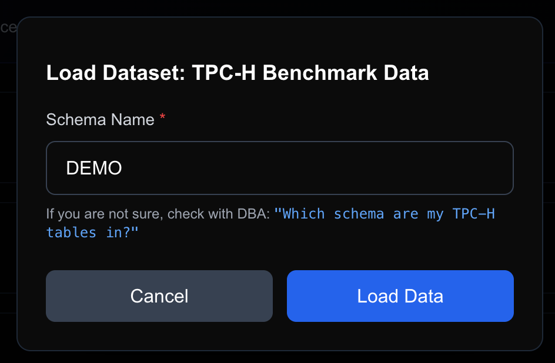

7. Wait while the status shows **Loading**.

   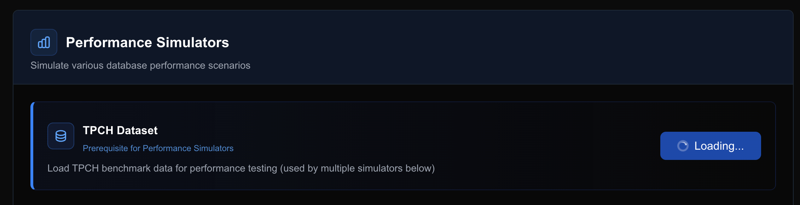

   > **⏳ Note:** This may take a few minutes depending on the size of the dataset.

8. When the load completes, the button changes to **Reload Data**.

   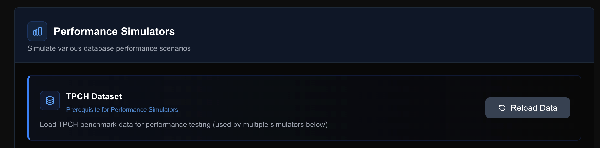

---

<h3 style="padding-left:14px; border-left:5px solid #EF9F27;">Step 3 — Run the WLM Sort Scenario</h3>

9. Click **WLM Queuing (a)** to open the WLM Sort Memory scenario.

   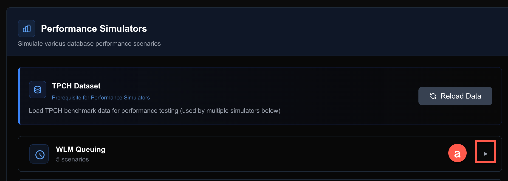

10. Click **Run Scenario (a)** to simulate the SORT issue.

    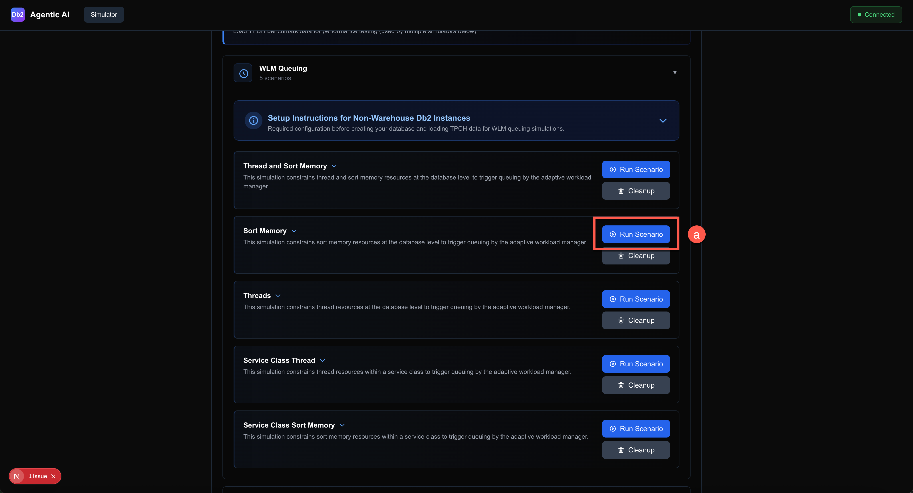

---

<h3 style="padding-left:14px; border-left:5px solid #EF9F27;">Step 4 — Monitor Inflight Queries in Genius Hub</h3>

1. In **Genius Hub**, click **Monitor (a)** in the side menu.

   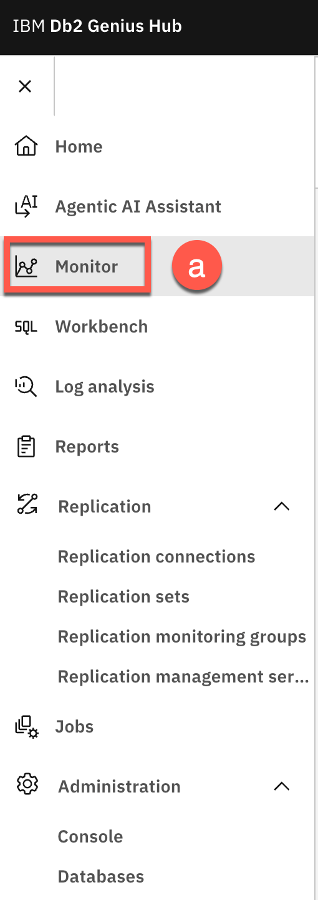

2. Make sure `DEMO_COL` is selected.

   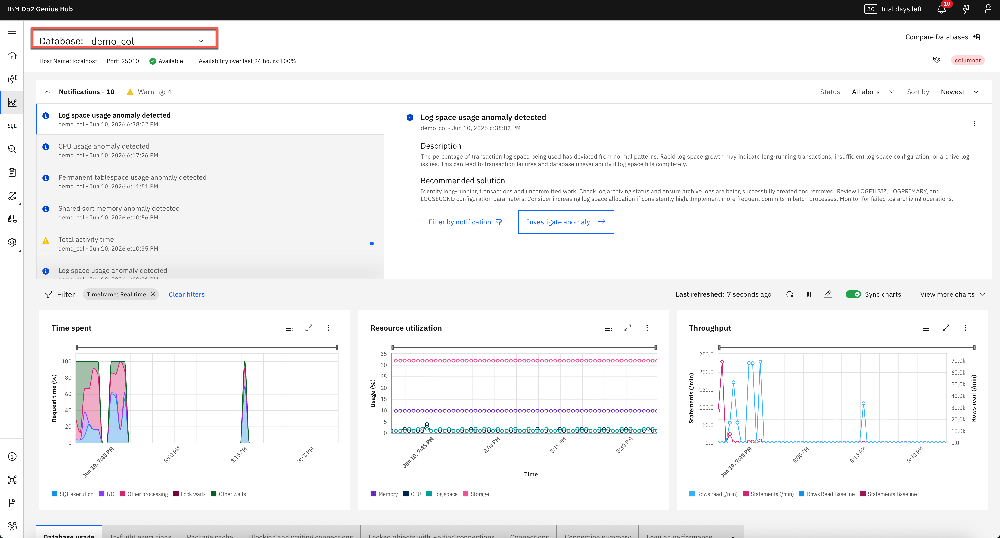

3. Scroll down and click **Inflight execution statement (a)**. Notice the queries are queuing.

   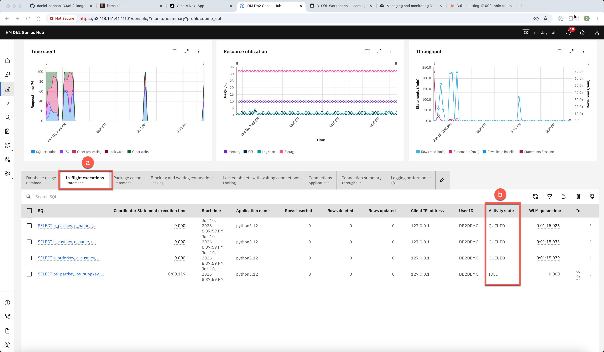

---

<h3 style="padding-left:14px; border-left:5px solid #EF9F27;">Step 5 — Ask Why Queries Are Queuing</h3>

1. Click **Agentic AI (a)** in the side menu and expand the **Assistant** window **(b)**.

   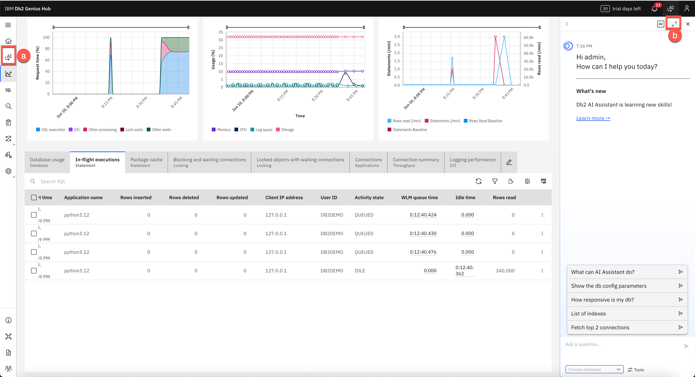

2. Close the Disclaimer.

3. Select the database `DEMO_COL` in the AI chatbox **(a)**.

   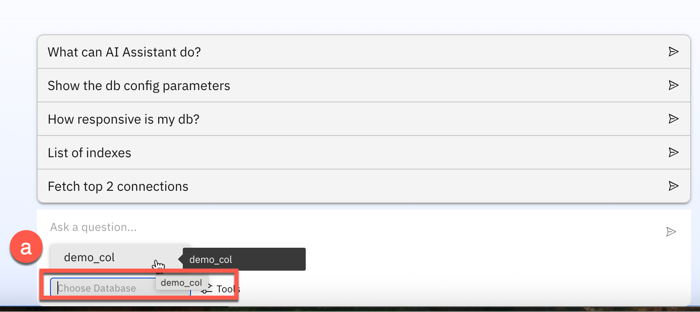

4. In the chat input, enter:

   ```
   Why are the queries in queue?
   ```

5. Watch the **Todo List** as the assistant autonomously works through each step — triaging the issue, identifying the domain, and delivering a root cause with evidence.

   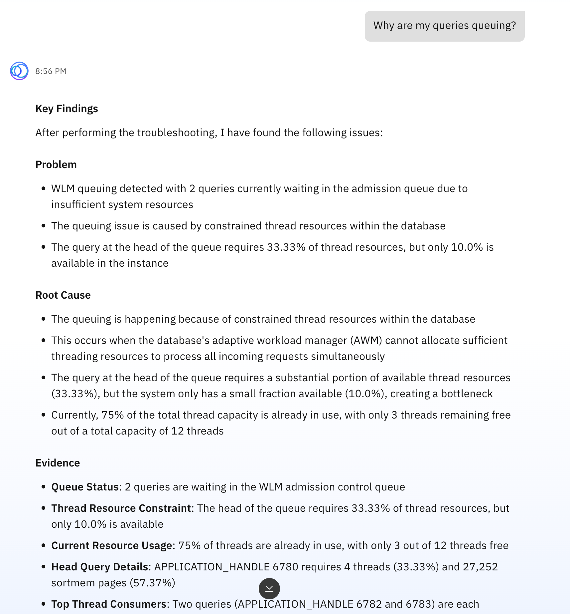

---

<h3 style="padding-left:14px; border-left:5px solid #EF9F27;">Step 6 — Review Root Cause and Resolution Steps</h3>

1. Scroll down in the response to review the **root cause**. The assistant identifies the specific resource constraint causing queuing, with a confidence rating and supporting evidence.

2. Continue scrolling to see the **Resolution** steps — including immediate remediation actions (such as reverting a configuration change) and long-term recommendations.

   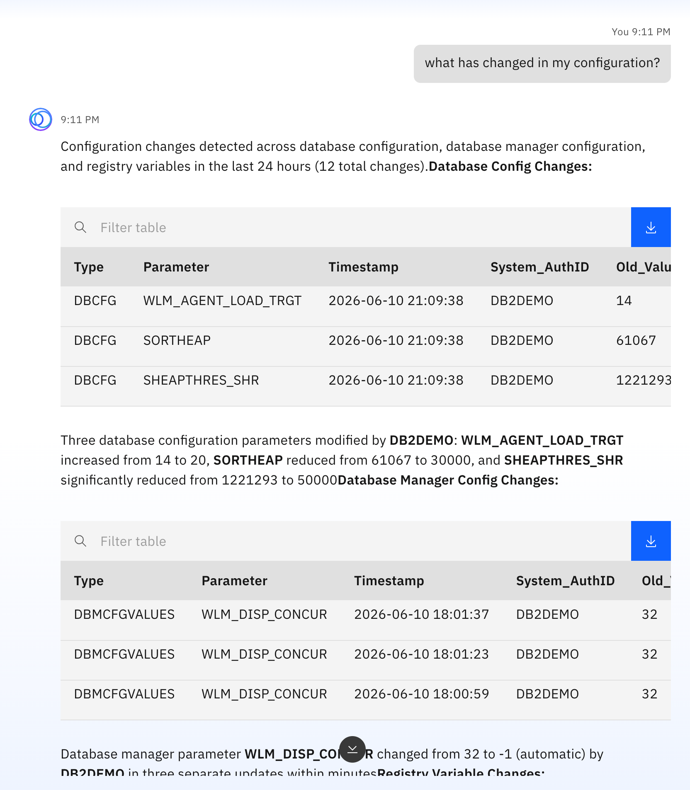

---

<h3 style="padding-left:14px; border-left:5px solid #EF9F27;">Step 7 — Apply the Fix and Approve</h3>

1. Ask the assistant to revert the configuration change:

   ```
   Revert SHEAPTHRES_SHR to its previous value
   ```

2. The assistant presents a **Database Configuration Update Request** showing:
   - The parameter (`SHEAPTHRES_SHR`)
   - The new value to be applied
   - The current (constrained) value
   - The exact SQL command to be executed

   Review the details carefully.

   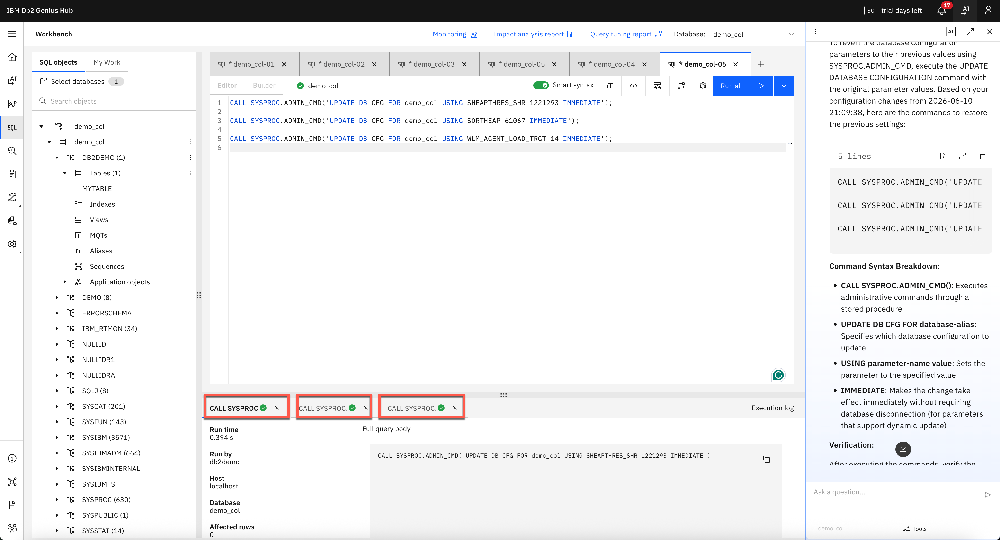

3. When satisfied, click **Approve** to authorize the change.

   > **ℹ️ Note:** Explicit human approval is required before any database configuration change is applied — you remain in full control.

   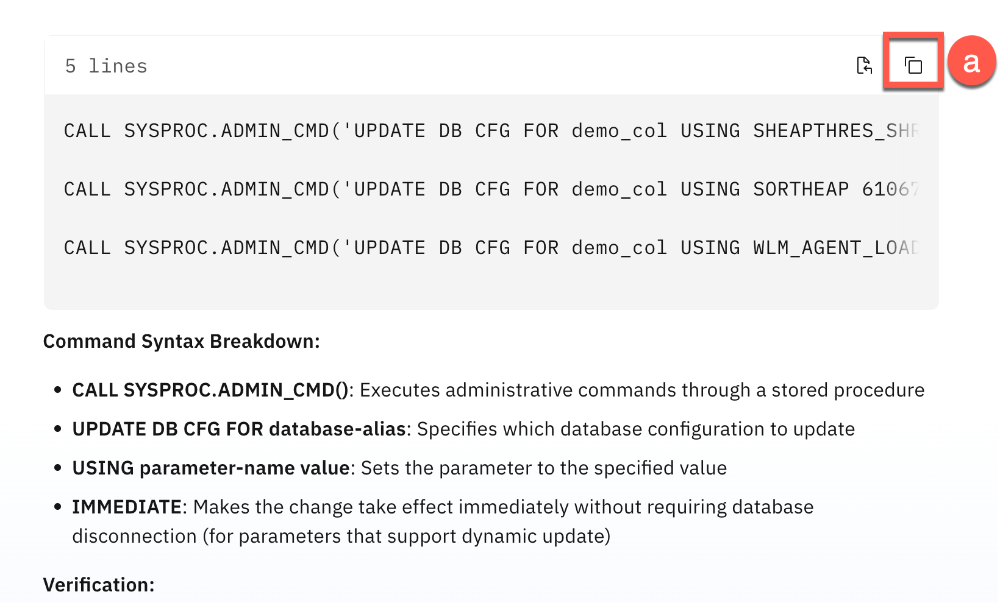

---

<h3 style="padding-left:14px; border-left:5px solid #EF9F27;">Step 8 — Verify the Fix</h3>

1. After approving, verify that the assistant confirms the configuration change was successfully applied.

2. Ask the assistant to confirm the queuing is resolved:

   ```
   Check if queuing issue is resolved?
   ```

   Verify that the response confirms the admission queue is now empty and all previously queued queries have been admitted.

   

---

<h3 style="padding-left:14px; border-left:5px solid #EF9F27;">Step 9 — Check In-Flight Executions</h3>

1. Return to the **Monitor** tab and click **In-flight executions** again.

2. Check the **Activity state** column — all queries should now show **EXECUTING** status.

   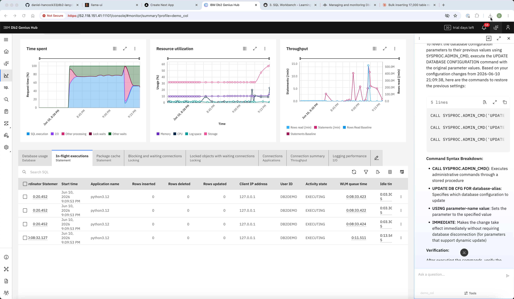

3. Close the Agentic AI Assistant.

---

> ✅ **This is the end of the lab.**

---

<h2 style="padding-left:14px; border-left:6px solid #1D9E75;">Summary</h2>

In this lab, you:

| Section | What You Did |
|---|---|
| **Setup** | Connected to the lab VM, started Genius Hub services, and configured the environment |
| **Basics** | Explored the Genius Hub UI, configured event monitors, and set up AI configuration |
| **SQL Workbench** | Created tables, ran queries, used Visual Explain, and applied AI Query Tuner recommendations |
| **Monitoring** | Analyzed CPU anomalies, generated reports, used the Agentic AI Assistant to investigate anomalies and reclaim tablespace space, and configured alerts |
| **Agentic AI Simulator** | Triggered a WLM sort memory queuing scenario, used the AI assistant to diagnose the root cause, approved a configuration revert, and verified all queries returned to EXECUTING state |

---

**[← Return to Introduction](00-introduction.md)**

---
